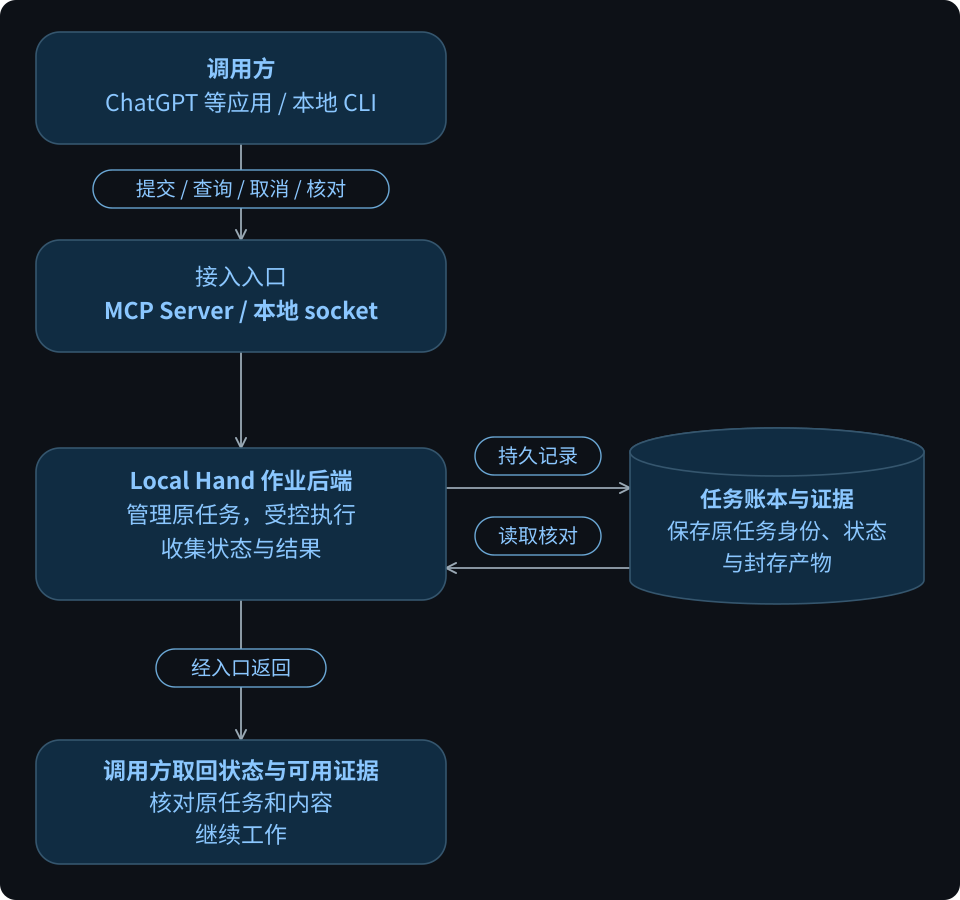

# infra-local-hand

受控本地执行器：让 ChatGPT 等应用或本地 CLI 在已配置的机器上提交有限任务，查询或取消执行，中断后沿原任务恢复查询，并取回可核对的结果与证据。

这里的“本地”指任务执行位置。调用方可以通过网络连接服务，实际操作仍受登记的任务类型、项目、权限和资源上限约束。

**当前版本：`0.2.0a1` alpha · Python 3.12 为当前验证基线。** 从源码构建 wheel；包安装、服务部署和现场验收是分别需要完成的步骤。生产资格尚未完成，仓库暂未附许可证。

## 它解决什么问题

| 使用者的问题 | Local Hand 提供什么 |
|---|---|
| 怎么让应用在指定机器上完成一项操作？ | 按登记的任务类型和资源引用准备、提交并执行任务 |
| 任务是在运行、已经结束，还是结果未知？ | 用原任务 ID 查询执行、业务结果和证据状态 |
| 连接中断后，怎样继续确认结果？ | 沿同一任务和账本核对，保留未知事实，避免重复执行业务 |
| 怎样取消任务？ | 记录取消请求、停止原执行，并继续核对退出证明 |
| 怎样把执行结果带回来？ | 返回状态、文件清单和分块证据，供调用方完整取回并校验 |

例如，对一个已登记项目修改单个文件：Local Hand 在任务独立副本中执行修改和固定验证，返回补丁、前后内容与验证输出。调用方核对证据后，再用[本地应用入口](docs/USAGE.md#land-a-verified-workspace-edit-locally)检查并应用到目标副本；任务完成本身不会自动提交或合并 Git。

## 从请求到可用结果

[查看原图（可缩放）](docs/diagrams/task-results.svg)

图中主线表达职责和结果关系。只有获准提交才可能启动业务；查询、恢复和读取围绕原任务进行，不会重放已执行的业务。返回结果仍可能是失败或未知，证据是否可取回以实际封存状态为准。

任务账本保存执行状态，封存证据保存可供核对的产物。调用方负责决定下一步做什么；Local Hand 按已登记的能力执行，并如实返回已观察到的结果。

## 怎么接入

| 接入方式 | 入口及职责 |
|---|---|
| ChatGPT 等支持 MCP 的应用 | 通过 MCP Server 调用任务工具；客户端需能访问配置的网络入口并完成认证 |
| 本地 CLI | `local-hand-jobs` 通过受保护的本地 Unix socket 访问作业后端，以操作系统身份映射鉴权 |
| 部署侧 | 配置允许的任务、项目、验证和预算；管理服务准备资源，MCP 服务处理网络请求 |

MCP 是通信协议，Local Hand 是执行服务；Tailscale 可以作为部署时的网络入口。术语、通信关系图、网络可达与授权的区别见[连接说明](docs/USAGE.md#客户端servermcp-与-tailscale-是什么关系)。

包中还保留 `local-hand-worker` / `local-hand-connect` 的 Task/Result 与 Git mailbox 入口，其配置和权限边界见[使用说明](docs/USAGE.md#explicit-admission)。它与作业后端的 MCP/CLI 入口使用不同协议，不能混用任务参数。

## 开始使用

1. **确认部署与权限。** 已有服务时先读取 `lh_capabilities`，确认允许的作业、项目或运行环境引用。新部署从[构建与安装](docs/USAGE.md#build-and-install)开始，再配置相应的管理服务、资源和认证；安装 wheel 不会自动建立可用的远程服务。
2. **准备并提交确定的任务。** 常驻入口使用新的任务 UUID 调用 `lh_job_prepare`；`PREPARING` 时沿同一 UUID 和参数查询，`READY` 后原样提交返回的 `request`。
3. **沿原任务查询或取消。** 保存 `operation_id`；响应丢失先查原任务，不能换一个 ID 重试结果未知的业务。取消已受理不等于进程已退出。
4. **取回并核对结果。** 查询状态；证据封存后，读取 `lh_evidence_manifest` 与 `lh_evidence_read_chunk`，完整组装文件并核对摘要，再决定如何使用结果。

任务工具、权限及状态合同见[作业接口](docs/a2-execution/ARCHITECTURE.md#ax-a07-mcp-工具和二进制证据r03r04r07r08r09)。固定 Ledger 本地验收的登记及调用示例见[使用说明](docs/USAGE.md#run-the-installed-ledger-a2-local-check)。

## 与 Artifact Ledger 配合

Local Hand 负责执行任务和取回结果；[Artifact Ledger](https://github.com/kongbu0621/infra-artifact-ledger) 为数字成果保存稳定身份、不可变版本、内容及来源关系。

可选的 `local-hand-archive` 能将已经成功封存的单个任务结果保存到独立 Ledger，再按返回的制品 ID 和版本 ID 读回原证据。当前消费者支持 Linux；归档不会重新执行任务，也不会自动应用补丁。安装、可信输入与重试方式见[结果归档](docs/USAGE.md#archive-and-read-a-completed-result-locally)。普通 Local Hand 使用不依赖安装 Ledger。

## 当前能力与边界

| 范围 | 已有能力与限制 |
|---|---|
| 提交、查询、取消、同任务恢复和证据读取 | 已在已有部署完成真实 ChatGPT 入口验证；具体任务的未知结果与证据缺口仍按原记录保留 |
| `host.inspect`、`workspace.edit` | 检查主机；在登记项目的任务独立副本中修改单文件、运行固定验证并返回结果。具体引用以服务能力列表为准 |
| `ledger.test.local_a2` | 已有可选固定作业，复用已登记的 Ledger 安装环境执行本地快照恢复检查；需要部署侧启用，不代表现场或 NAS 验收已通过 |
| NAS 新作业 | 当前被实现屏蔽；历史任务记录仍保留 |
| 平台 | 核心包有 Linux/Windows 验证；当前作业后端、本地 socket 与管理服务按已有 Linux 部署使用，不能据此宣称所有入口都已跨平台验收 |

任务不能携带任意 shell 命令或自行扩大项目、路径与权限范围。身份校验、任务关联、数据保护及资源上限始终生效；任务、日志、凭据和原始证据保存在部署者的私有环境。

工具调用存在偶发 `-32603` 的保留记录，根因尚未确认；连接错误不等于任务没有执行。已有任务先按原 ID 查询，仍未知的结果如实保留。

## 文档

| 想了解什么 | 阅读入口 |
|---|---|
| 如何安装、连接、应用补丁或归档结果 | [使用说明](docs/USAGE.md) |
| 任务、权限、取消、恢复和证据的精确边界 | [作业接口与架构](docs/a2-execution/ARCHITECTURE.md) |
| 产品需求及早期 Task/Result、Git mailbox 设计 | [需求](docs/REQUIREMENTS.md) · [架构](docs/ARCHITECTURE.md) |

开发过程、阶段记录和任务接续见[开发与接续记录](docs/DEVELOPMENT.md)；参与维护从 [AGENTS.md](AGENTS.md) 开始。
