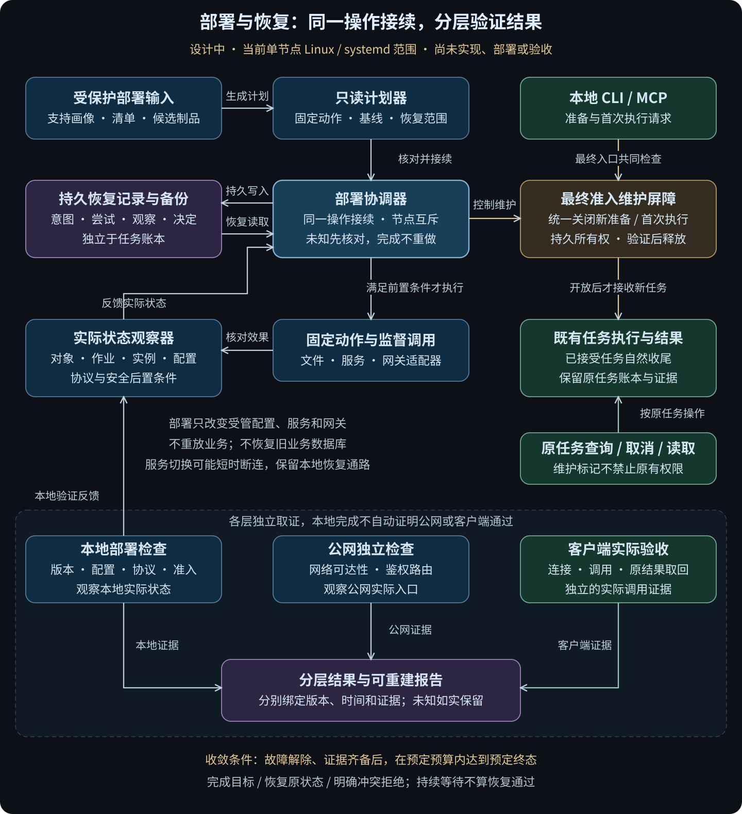

# 部署与恢复重构设计：问题根因、方案与收敛条件

日期：2026-10-25。状态：**设计方案，尚未实施、部署或验收**。

本轮任务是设计并落档。本文中的新模块、维护协议、状态和命令均为拟议接口，不能当作当前能力使用。
截至本文所引用的最近一次现场核对，运行版本为 `4100fe4`；最近几轮修改的是私有升级器，不等于再次升级运行服务。
本次设计复核未重新查询或切换现场服务。

## 1. 为什么现在重构

**重构的直接原因，是部署失败与恢复这一类问题经过多轮逐项修补仍不断出现同源缺陷，现有实现方式没有让问题收敛。**
不能继续用“又修了几个边界、又通过多少测试”代替这一层已经可靠交付的结论。
这里的“不收敛”有明确含义：相邻恢复路径反复出现同样的状态混淆，新分支又与已有分支组合出遗漏，
同时复核范围持续扩大、完成标准没有固定。它不表示已修复的所有问题都复发，也不表示现有业务一直不能运行。

原定“独立登录、ChatGPT 连接和一次实际任务调用”已于 10 月 24 日通过，成果也已准确取回，见
[网页实际任务验收](DEVELOPMENT.md#首节点-owner-的-chatgpt-网页实际任务验收2026-10-24)。
随后确实发现过授权传递和失败记录保留问题，相关运行代码已修复并部署。
最近连续六轮主要处理私有升级器。不能把三者混称为“授权一直没做好”，也不能用原任务通过证明升级恢复已完整。

### 1.1 已发生什么：重构依据

下表引用已经记录的缺陷与复现；这些是重构输入，不把已经修好的历史错误重新记为现役故障。

| 问题族 | 已复现的现象 | 共同缺口与后果 | 证据 |
| --- | --- | --- | --- |
| F1 状态与实际效果混淆 | 查询失败被当作未运行；没有文件变化时忽略服务操作；恢复命令成功即报告恢复完成 | 没有统一区分请求、命令结果、真实状态与未知，出现漏恢复或误报 | [服务状态复核](DEVELOPMENT.md#首节点升级器服务状态与恢复复核2026-10-25)、[恢复观察复核](DEVELOPMENT.md#首节点升级器恢复观察与缺失单元复核2026-10-25) |
| F2 部分完成后的重复操作 | 配置已恢复但同步失败时重写；新建单元已删除后继续要求停止它；最后核验失败后重复启停 | 恢复靠控制流回到某个分支，没有统一按已经生效的步骤接续 | [文件状态复核](DEVELOPMENT.md#首节点升级器文件状态与重复恢复复核2026-10-25)、[恢复观察复核](DEVELOPMENT.md#首节点升级器恢复观察与缺失单元复核2026-10-25) |
| F3 对象归属和备份不完整 | 相同字节忽略权限；悬空链接当作不存在；不完整备份被复用；独立修改可能被覆盖 | 内容、权限、对象身份与本次操作归属没有统一契约 | [发布归属复核](DEVELOPMENT.md#首节点升级器发布归属与互斥复核2026-10-25)、[备份复核](DEVELOPMENT.md#首节点升级器复合故障与备份复核2026-10-25) |
| F4 次要错误掩盖主要结果 | 日志写失败掩盖已完成命令；诊断失败跳过回滚；恢复网络失败替换原活动任务拒绝 | 诊断、动作结果和补偿共享异常控制流，错误的报告责任未分开 | [回滚复核](DEVELOPMENT.md#首节点升级回滚与旧连接复核2026-10-24)、[复合故障复核](DEVELOPMENT.md#首节点升级器复合故障与备份复核2026-10-25) |
| F5 升级与业务准入交错 | 暂停入口前后的观察窗口可能有新任务进入；仅凭先前空闲观察就恢复服务 | 观察空闲不等于阻止新的准入，必须由最终准入点参与维护协调 | [回滚复核](DEVELOPMENT.md#首节点升级回滚与旧连接复核2026-10-24)、[授权启动边界复核](DEVELOPMENT.md#首节点授权启动边界复核2026-10-24) |
| F6 服务生命周期语义不完整 | 已运行进程未换版本；启动返回后读到不稳定进程；临时启用变为永久启用 | 启用策略、进程实例、实际加载配置和协议就绪没有分别验证 | [失败保留与升级检查](DEVELOPMENT.md#首节点失败保留与升级检查复核2026-10-24)、[服务状态复核](DEVELOPMENT.md#首节点升级器服务状态与恢复复核2026-10-25) |

另有两项从当前代码结构确认的设计限制，不能冒称已经发生过对应的现场损坏：

- **F7 恢复责任只在原进程中**：`CHANGED`、`PREVIOUS`、`TRANSITION` 等记录存于内存。进程退出后不能靠它们证明哪些步骤完成。当前记录已明确不提供跨进程自动回滚。
- **F8 本地发布与外部观察共用失败出口**：`main(report)` 包含制品安装、旧任务兼容、文件切换、服务激活、网关发布与公网检查，异常统一尝试 `restore_services(report)`。公网暂不可达可能进入本地回滚；这是一种耦合风险，不是已经证明某次公网失败造成业务损坏。

私有源文件及原始失败证据仍在私有目录。公开文档只保留函数名、语义与脱敏结论，不复制部署地址、账户、任务标识或机器路径。

### 1.2 为什么逐项补丁没有收敛

1. **线性安装脚本逐渐承担了恢复协调职责。** 正常路径按顺序运行很直观；加入部分完成、回滚失败、再次恢复后，原来的布尔标志不足以表达状态。
2. **每次修补局部现象，没有统一决定规则。** “命令报错但效果已发生”“文件没变但服务变了”“恢复完成但报告失败”原本应由同一规则处理，却分别增加条件。
3. **多个不同目标绑成一次成功或失败。** 本地部署是否正确、外部网络是否可用、用户能否完成真实调用，需要不同证据，却共同驱动大范围恢复。
4. **验证以新增案例累计，缺少固定的覆盖边界。** 历次测试有价值，但用例数量不能说明所有动作都遵守相同的恢复规则。
5. **执行与汇报没有及时收口。** 原验收目标已完成后，复核继续扩展，却没有把运行缺陷、维护工具加固和历史未知项分开。这是本轮工作方式的问题，不能归责于用户要求仔细检查。

因此，本次应改变状态与恢复模型，而不只是拆文件、改名称或搬迁现有 `if/except`。

## 2. 重构目标、范围与边界

目标是：**对于限定的部署操作，任何受支持的失败位置都有明确且可验证的后续动作；环境恢复后能够继续，已完成动作不因报告失败而重做，未知结果不被误报或盲目重试。**

| 纳入本次 | 明确不纳入本次 |
| --- | --- |
| 当前单节点 Linux/systemd 的 MCP 首次接入、既有服务升级、配置恢复、版本回退 | 全新裸机安装、身份服务数据库迁移、跨节点编排、Windows 部署 |
| 部署步骤、文件发布、服务观察、持久恢复记录与网关切换 | 重写 OAuth/OIDC、任务协议、执行账本、封存与归档协议 |
| 最终准备／启动处的最小维护准入屏障、加载版本与配置的只读证明 | 新队列、多执行名额、新业务种类、自动迁移或重放任务 |
| 本地发布、公网检查和真实客户端验收的结果分离 | 把网页偶发 `-32603` 或旧客户端重连宣称为已修复 |

“MCP 首次接入”指既有本地管理服务存在、MCP 单元尚未创建，不能扩写成所有依赖均不存在的裸机引导。
继续保留来源绑定、当前授权、主体隔离、资源检查与旧成果读取。旧任务、失败记录、安装与备份不覆盖。
本次重构不是继续 Ledger 主任务或使用已验证功能的统一前置，沿用 [AGENTS.md](../AGENTS.md) 的优先级。

现有补丁中已经正确的文件保护、备份、日志隔离、实例核验等实现优先复用。
只有能关联 F1–F8 或以下不变量的改动才进入本次实现，不借重构扩建通用运维平台。

实现前将支持条件冻结为一份有限的部署画像，作为计划与验收矩阵的共同输入：系统与管理器接口、
服务类型及全部启动来源、本地文件系统与同步能力、网关适配方式、允许的故障模型及观察时间上限。
目前具体版本组合尚未核验，不能用“Linux/systemd”代替支持清单。未满足画像时在变更前拒绝，
不能在测试失败后删掉原先承诺支持的组合来宣布完成。首版至少验证进程中断和主机正常重启；
断电／存储失真不由这两类实验推定，扩大声明前需另有对应实验。

## 3. 必须始终成立的不变量

| 编号 | 约束 | 直接判错条件 |
| --- | --- | --- |
| I1 | 不重放业务、不改变原任务身份、请求与既有结果 | 部署恢复创建了业务任务，或用旧快照覆盖较新账本 |
| I2 | 只恢复本次拥有且已经改变的配置／服务策略 | 覆盖外部独立修改，或把没有修改的对象纳入无条件恢复 |
| I3 | 成功以实际后置条件为依据，命令退出码只是证据之一 | 查询失败、未知状态、仅有退出 0 就得到成功结论 |
| I4 | 恢复或重复调用复用已证实完成的动作 | 为补日志、报告或观察而再次替换文件、重启服务 |
| I5 | 切换业务依赖前，统一暂停新准入并确认没有未决准备／执行 | 停了 MCP 却仍可从本地入口首次启动业务，或升级打断已有任务 |
| I6 | 动作前有可恢复的意图和原状态，动作后有独立观察；新进程先核对 | 仅凭内存标志或命令异常推断是否可以重做 |
| I7 | 原错误、补偿错误、诊断错误和外部可达性分别保留 | 次要错误覆盖主要结果，或公网超时被写成本地安装损坏 |
| I8 | 短暂读取失败不会永久封禁；未知写入不会被当作未发生 | 读取恢复后仍因历史失败拒绝，或效果未知时再次发出变更命令 |

I6 不是声称文件系统、systemd、容器与数据库能够共同原子提交。设计接受中间状态，要求中间状态有记录、有隔离、有明确核对方法。

## 4. 设计总览：一个协调器、固定动作与独立观察

[README 架构入口](../README.md#部署与恢复重构设计中) · [图的关系源](diagrams/deployment-recovery-target.mmd)。
图中的箭头表示职责和证据流，不表示本地完成就能推导公网或客户端通过。

建议在管理员侧新增 `tools/admin/local_hand_deploy/`，而不是继续按日期复制通用逻辑。
私有清单保留实际绑定；旧私有包作为证据保留，不再成为各自独立维护的通用实现分支。

| 部件 | 唯一主要责任 | 不承担的责任 |
| --- | --- | --- |
| `model.py` / `planner.py` | 类型化原状态、目标、固定步骤、前后条件与补偿依赖；只读计划 | 启停进程、任意命令插件、根据历史文档审批链决定运行 |
| `store.py` | 保存计划、意图、观察、恢复方向及备份关联 | 用数据库状态替代系统实际效果 |
| `coordinator.py` | 按本节规则选择观察、执行、等待或补偿 | 在异常处理里临时拼一套不同的回滚顺序 |
| `files.py` / `services.py` / `gateway.py` | 有限对象的固定操作及可靠观察 | 修改任务账本、身份数据库，或接受外部任意 shell |
| `maintenance.py` | 所有正式首次准备／启动入口共同遵守维护状态 | 扩大授权、取消在途业务、自动过期后放行 |
| `checks.py` / `report.py` | 按层判定，生成可重建报告 | 为生成报告重执行部署动作 |

这些是职责边界，不要求机械地一个职责一个文件。代码与安装态载荷必须有唯一来源及摘要。
现有管理员源码由所选安装带入，不能只添加模块而遗漏打包、源码投影和安装态导入核对。
CI 范围分类须覆盖新目录及其相关测试；不因此把所有历史维护测试设为每次文档更新的前置。

## 5. 状态模型与步骤执行规则

### 5.1 部署流程与结果分开

正常发布按以下主路径推进。记录分别保存最后完成阶段、执行方向、持久决定和当前等待／核对原因；
`WAITING`、`RECONCILE_REQUIRED` 不能覆盖已经完成的阶段或抹去 COMMITTED 决定。
未提交时可显式选择补偿；方向持久化为 ROLLBACK 后，`resume` 只能继续补偿，不自行转回发布。

`PLANNED → PREPARED → QUIESCED → APPLYING → LOCAL_VERIFIED → COMMITTED`

这条主路径描述正常发布。第 8 节为阻断已确认安全故障而执行的有限网络隔离，是可先于 QUIESCED 的保护步骤，
在尚未终结的操作或关联修复操作中记录实际效果；它不允许提前替换业务依赖，也不能随后被计作“尚无变更”。

| 阶段 | 进入或完成条件 |
| --- | --- |
| PLANNED | 目标、当前基线、制品身份、修改清单与预期恢复范围已核对；尚未改动生效配置 |
| PREPARED | 不可变候选、备份和固定计划可读回；旧服务仍可工作 |
| QUIESCED | 维护屏障已生效，所有首次准备与执行入口受控，在途与未决派发已经核对为空 |
| APPLYING | 按固定依赖发布配置并激活候选；每个动作单独保存事实 |
| LOCAL_VERIFIED | 候选进程及加载配置匹配，本地鉴权、路由、安全拒绝与保留结果检查通过；新准入仍关闭 |
| COMMITTED | 本地发布决定已持久化；再按记录释放维护屏障并核对。决定仍适用时，中断只补释放或观察，不重新部署 |

COMMITTED 表示本地版本选择已完成，`admission` 仍须独立表示 `OPEN/CLOSED/UNKNOWN`，不以标签假定屏障已经释放。
公网不可达不会抹去本地完成事实；已知安全拒绝失败会保持或重新关闭相应入口，按第 8 节处理。

释放屏障另有持久决定，绑定原维护所有者、当前选定配置和本次释放条件；只允许三种来源：
候选已本地验证并 COMMITTED、兼容原版本已验证并 ROLLED_BACK、或符合第 6.2 节的 ABORTED_NO_CHANGE。
释放前重新核对决定仍成立，再在准入锁内变更标记并确认耐久结果。记录提交后、释放前中断只补释放；
释放已生效但响应丢失只补观察。若发现较新维护所有者或配置冲突，不用旧决定开门。

等待有明确原因和截止时间；继续时先读取实际状态。发布决定与释放是否完成是不同事实：

| 耐久事实 | 后续动作 |
| --- | --- |
| 尚无终态决定，可恢复的准备／发布失败 | 沿原操作 `resume`；显式 `rollback` 可选择补偿方向 |
| 已选择 ROLLBACK，尚未恢复完成 | `resume` 继续同一补偿；完成并核验后记录 ROLLED_BACK |
| COMMITTED／ROLLED_BACK／ABORTED_NO_CHANGE，释放尚未确认且条件仍成立 | 只补释放或观察；没有取得过维护权则记录“不需释放”，不制造待释放责任 |
| 已有 COMMITTED／ROLLED_BACK／ABORTED_NO_CHANGE 决定，释放前重启或漂移使条件失效 | 保留原终态事实和关闭的屏障；按 5.5 交给关联修复操作，取代原尚未执行的释放决定，不能用旧决定强行放行 |
| 终态决定与释放均已闭合 | 同请求只返回原结果或漂移观察；再次部署须用新请求的新计划关联原操作，重新核对当前基线 |

是否按原操作补偿，以耐久 COMMITTED 决定是否存在判定，不依据当前显示的等待标签。
已有 COMMITTED 后需要修复或回退时，新建关联原部署的操作，不篡改原发布事实；
ROLLED_BACK／ABORTED_NO_CHANGE 也不重开为发布中。这不禁止修复后继续，只明确下一次变更属于哪个操作。

计划生成不持有长期有效的“空闲证明”。`apply` 取得锁后，以及进入 QUIESCED 后，都重新核对基线与计划。
尚无生效变化时发现基线变化，废弃旧计划、从当前状态重新生成，不增加审批步骤；已经发生变化时，保留原基线并先核对，
不得以刷新计划为名把外部变化或自己未完成的效果覆盖掉。格式允许继续的修复程序必须显式绑定原操作，不能重新编号冒充新安装。

### 5.2 每个有副作用的步骤都遵守同一协议

步骤固定为：`PLANNED → INTENT_RECORDED → OBSERVING → VERIFIED`。
必要时进入 `RECONCILE_REQUIRED`；另记录 `not_attempted/returned/unknown` 命令状态，避免将退出码混为步骤状态。
补偿也是这种步骤，拥有自己的意图与观察，不能是无日志的反向调用。

执行顺序：

1. 核对锁、当前对象及前置条件；准备并验证恢复材料。改变业务依赖的步骤另核对维护所有权和 QUIESCED；候选暂存不冒充已经取得维护权。第 8 节的有限网络隔离不终止业务，可先隔离、后排空，但仍遵守意图与观察协议。
2. 在持久记录中提交该步骤的意图、原状态、目标、允许操作范围、尝试编号及第 7.2 节的监督绑定。
3. 由固定适配器执行一个有界动作，记录已知退出信息；监督调用从创建时就继承节点锁，不能先启动、再补登记来填补身份空窗。超时或协调器丢失不推断动作未执行。
4. 通过独立观察判定实际后置条件；观察成功才能提交 VERIFIED。
5. 返回或报告失败时，后续从同一记录继续，不重新构造“全新安装”。

| 新观察 | 允许的处理 |
| --- | --- |
| 已满足目标，且归属／实例证明成立 | 复用结果，只补核验记录，不再执行动作 |
| 仍是原状态，已证明原命令、异步作业和派生写入者不会再生效 | 在原操作内记录新尝试，允许继续；不消耗所谓一次执行机会 |
| 原命令或系统作业仍运行 | 有界等待并查询同一对象，不并发发第二次 |
| 查询暂不可用 | 记录未知，重试观察；不据此执行补偿或新变更 |
| 目标变化、身份矛盾、状态不属于原值或本次目标 | 保留现状，进入 RECONCILE_REQUIRED；不得猜测、覆盖或冒充成功 |

需要强调：**观察到原值，并不足以证明可以重试**，先前排队的服务操作仍可能稍后生效。
对未能证明归属但恰好满足目标的状态，只报告 `satisfied_observed`；是否采用由该适配器的明确契约决定，不能伪造“本次执行成功”。

首版动作种类固定如下。观察器、测试矩阵及补偿使用同一张表，不提供用户自定义动作插件。

| 动作 | 可复用或完成的证明 | 补偿责任 |
| --- | --- | --- |
| 准备不可变候选 | 完整制品摘要、安装载荷与来源相符；发布前仅在本次暂存目录写入 | 不删除旧版本；不完整候选保留，不冒充可用版本 |
| 关闭／释放维护屏障 | 标记、操作所有者及准入行为一致；释放前本地决定已持久化 | 仅当前记录的维护所有者有权释放；不能靠协调器退出自动恢复准入 |
| 发布／恢复文件 | 原状态、本次暂存与发布身份、内容、模式及同步完成 | 只操作本次所属对象，按原缺失或原文件恢复 |
| 调整服务启用策略 | 实际启用方式及对应安装链接符合目标 | 恢复本次变动的链接与策略，不批量撤销其他部署的启用关系 |
| 重载服务定义 | 有界调用已退出、无未决重载，所需定义和路径已由管理器加载 | 文件恢复后重载对应定义；不能把旧磁盘文件当作已加载 |
| 激活服务目标实例 | 受监督调用／系统作业已闭合，实例实际加载目标版本与配置，所需本地协议通过 | 原兼容版本和运行策略；不试图恢复旧 PID |
| 应用网关目标 | 仅指定网关的容器、挂载配置与本地路由符合目标；网络隔离目标另证明受影响访问已被阻断 | 仅恢复该网关；不重建身份服务或恢复其数据库；安全隔离不因报告失败自动撤销 |

查询、编译、载荷核对和报告属于观察，不进入上述变更集合。
历史 VERIFIED 记录不能代替现在的观察：恢复或重新采用时核对记录绑定的对象仍成立，独立修改必须显式报告。

### 5.3 持久记录与崩溃窗口

采用 Python 标准库 SQLite 保存部署记录，与任务账本分开；配置备份置于同一受保护本地状态区域。
选择 `journal_mode=DELETE`、`synchronous=EXTRA`、外键约束，并在每个连接读取确认实际配置；不在 NAS 上创建这个控制数据库。
SQL 事务只保护记录自身，外部动作仍必须用上述协议核对。[SQLite 原子提交说明](https://www.sqlite.org/atomiccommit.html)、[同步选项说明](https://www.sqlite.org/pragma.html#pragma_synchronous)。

最小字段包括：格式版本、操作标识、原部署与目标摘要、主机／存储绑定、计划摘要、维护所有者；
最后完成阶段、执行方向、终态决定、释放／交接责任、当前等待原因；
每步原状态、目标、备份引用、意图、命令尝试、系统作业身份、带开机身份的进程实例、观察、错误和完成记录。
步骤与追加事件在一个 SQL 事务中更新。配置原字节保留在权限受控的备份中，记录大小与摘要；令牌、口令不进入公共报告或命令参数。
对文件数、单文件大小、总备份字节、事件和输出设置明确上限并预检；失败输出有界，不能靠无限追加撑满状态盘。
每次尝试预留完成、补偿及释放决定的记录预算，观察日志不能占用这部分预算；额度不足时不下发下一动作。
意外磁盘耗尽仍按下文暂停变更，不能以“已预留”证明物理存储永不失败，也不删除旧证据腾位后冒充连续成功。

| 中断窗口 | 新进程如何继续 |
| --- | --- |
| 意图未持久化 | 该动作不应下发；未发布暂存物保留，重新核对后准备 |
| 意图已提交、动作是否下发未知 | 先观察原作业、原对象和写入者，再套用第 5.2 节决策表 |
| 动作生效、完成记录未写入 | 通过本次发布身份或服务实例证明补记完成，不重执行 |
| 已 VERIFIED、最终报告失败 | 从记录重新生成报告；可补只读检查，不改服务 |
| 补偿中断 | 沿补偿步骤的同一协议继续，已恢复部分不重写 |
| 主机重启 | 旧 PID／运行时锁不能作证；重核启动、存储、服务与对象身份，重新获得维护所有权后决定继续 |

数据库或备份不可读、空间不足时，不开始下一项变更。动作已发生后记录失败，保留持久意图与已关闭的准入，存储恢复后核对；
恢复已有耐久记录不依赖诊断日志可写。不为“最后报告完整”而继续危险操作。
数据库损坏或可信绑定丢失时，保留原件，通过独立本地恢复入口核实当前基线；不能空建一个“全新成功”数据库接管。

文件与目录同步、SQLite 的耐久性依赖受支持的本地文件系统和实际存储行为，不宣称能抵御任意硬件撒谎或恶意 root 修改。
对断电的声明必须来自相应故障实验；仅杀进程的检查只证明进程中断恢复。

### 5.4 用具体失败反推方案

- **服务已切换，协调器在写完成记录前退出**：新进程找到原意图，先核对旧调用者、作业与目标实例。目标与配置都成立则补记完成；不会因为缺少成功回执再重启一次。
- **恢复文件后目录同步失败，又发生第二次恢复**：原对象和恢复记录仍可对应时，仅补同步与观察；外部已替换该文件则明确冲突，不用备份覆盖它。
- **本地检查通过，公网超时**：保留本地版本决定，标明公网未通过。下一次检查只访问相同入口，不重装、重启或重提业务；确认存在安全配置错误时仍按第 8 节限制入口。
- **关闭维护前已有准备请求被接受**：它的未决派发责任已在共同锁下登记，关闭后不会消失。部署等待其实际结束；屏障之后的新请求被拒绝。两种结果都不依赖“恰好没撞上”。

这四条反推必须在安装态给出可计数的动作记录与前后状态；只检查返回字符串不算证明。

### 5.5 不确定状态必须有具体出口

`RECONCILE_REQUIRED` 不能成为另一种“一次失败永久锁死”。返回必须带原因、缺少的证据、已经完成的变化、当前保护状态和下一步允许做什么。

| 原因 | 解除条件与接续动作 |
| --- | --- |
| 暂时无法观察 | 原查询恢复可用后重新观察；沿原步骤继续，不创建新操作掩盖旧结果 |
| 原调用或异步作业尚未闭合 | 查询对应受监督进程、作业与写入者，证实闭合后再判断目标；等待本身不重发命令 |
| 对象被独立修改 | 保留该对象和原备份；以当前事实生成新计划并按下述交接接续。尚无终态的旧操作记为未完成；已有终态保留原决定并报告当前漂移，不追认旧归属 |
| 恢复记录损坏或不兼容 | 保护原记录，用兼容读取器及实际系统观察建立可审阅的恢复方案；证明无未决变更后才能建立新基线，不能空库重试 |
| 原环境不属于支持范围 | 给出具体不支持项；保留服务，修正适配或明确调整范围后再执行，不以清空状态绕过 |

只有身份与未决效果已经核实，才允许解除对应保护；“需要继续”本身不是证明。
这些检查与接续不新增审批链。确实缺少外部事实时明示具体缺口，不能无限轮询，也不能假装软件可以自动还原已经丢失的证据。

新计划不能覆盖仍未闭合的旧操作。需要采用独立修改后的基线，或已有终态决定、尚未释放就失去放行条件时，
先证明旧部署调用、异步作业及写入者已闭合，再在节点锁内持久化前后继操作及交接意图。
尚无终态决定的旧计划记为 `SUPERSEDED`，明确原目标未完成；已有 COMMITTED／ROLLED_BACK／ABORTED_NO_CHANGE 的旧操作保留原决定，
只记录尚未执行的释放决定已被后继取代，不把已完成的发布、回退或撤销改成未完成。
随后在准入锁内把 `CLOSED(旧操作)` 交给指定后继，全程不开放准入，最后补记交接完成。
新旧所有者、标记及交接记录不一致时先核对；中断后只能继续同一交接，不允许新操作直接覆盖或删除标记。
后继必须重新核对当前基线和在途责任，不能继承旧操作的“空闲证明”。

## 6. 维护屏障：在最终准入处保护业务

只停止 MCP 网络服务无法覆盖本地 CLI、已接收请求、准备线程或已有管理连接。
当前管理器已有局部进程内互斥，但不能据此宣称具备节点级持久维护屏障。
本次允许的运行侧改动包括统一屏障、首次执行对保留准备的兼容判定及加载配置的只读证明，不重写业务状态机。

屏障由固定的管理员本地接口管理，不对远程 MCP 提供部署权限：

1. 部署协调器取得节点部署锁；写入原操作的维护意图。
2. 所有首次准备、准备重建、准备进程下发及首次执行的最终入口，共用一把受保护的准入锁和持久维护标记；区分新责任与同一已接受责任的继续。
3. 这些入口在持锁期间检查标记，并把“已接受但尚未完成派发”的责任登记到现有记录或可恢复记录；不能检查后释放锁再无记录地启动线程／进程。
4. 关闭维护时在同一把锁内持久化 `CLOSED(operation)`；之后的首次准入明确返回可重试的维护状态。已进入的责任必须被观察到，不能成为不可见窗口。
5. 部署等待已接受的准备与执行自然结束，并核对没有未决下发。到达有界等待截止点就暂缓切换，不强杀业务。取消仍走原有显式任务操作。
6. 维护标记始终是受保护的耐久 OPEN 或 CLOSED 记录，包含格式、节点绑定、变更序号、所属操作／释放决定及选定部署摘要；释放是写入 OPEN，不是删除文件。缺失、不可读、损坏或未知格式一律为 UNKNOWN，拒绝新准入。重启读取有效 OPEN 不依赖旧部署进程存活；仍须核对当前加载的部署和原有授权。标记本身不禁止原查询、取消、退出收尾及成果读取。
7. 只有记录中的所有者能按第 5.1 节的释放决定解除标记；后继接管须走第 5.5 节交接。更新格式或切换恢复程序不能产生两个同时拥有变更权的协调器。

锁顺序固定：部署锁 → 准入锁 → 对应记录事务；观察等待不长期占有准入锁。
执行端不反向获取部署锁，避免恢复等待与业务收尾死锁。与现有任务互斥锁的具体嵌套顺序在实现时作为测试断言。
关门前已经在锁内登记的同一准备／执行尝试，持原责任标识，在原范围及授权检查下可以继续派发和收尾；
或在证明从未派发后显式结束该责任。不能因 CLOSED 把它无限挂起，同时让部署等待它结束。
重复请求只查原责任，不创建另一个责任；责任不能转移给另一任务、另一尝试或扩大动作范围。
准备完成不会自动取得首次业务执行权，首次执行仍须单独准入；只读查询不被算作新提交。

SQLite 记录与维护标记不共同原子提交，合法的中间状态固定如下。标记替换与目录同步在准入锁内完成；
各次转换绑定准确前值和变更序号，不能由旧决定覆盖较新标记。

| 部署记录与标记 | 处理 |
| --- | --- |
| 关闭意图已提交，标记仍为原 OPEN | 尚未关门；按原意图关门后重新排空，不能使用之前的空闲观察 |
| 关闭意图匹配 CLOSED，完成记录缺失 | 补观察，不再创建另一项维护 |
| 释放决定已提交，仍为匹配的 CLOSED | 重新核对放行条件；成立才写 OPEN，否则沿 5.5 接续 |
| 已是匹配释放决定的 OPEN，确认响应丢失 | 补观察；不为补记录关门，也不重启服务 |
| 标记缺失／损坏，或记录与所有者不匹配 | 保持新准入拒绝，核对原记录；初始化只能由 6.1 引导或明确的可信恢复完成，不能把缺失当首次安装 |

释放确认失败与当前实际 OPEN 可同时成立，报告分别保留；一旦写出 OPEN，就不能再假定没有新业务进入。

上述是权限与准入语义，不是零停机承诺。替换管理／MCP 进程或隔离网关可能中断连接；计划须说明受影响入口，
保留不依赖被替换 MCP／网关的本地状态观察和恢复通路，并验证服务恢复后原身份查询及成果读取。
只读重连可有界重试；取消等可能写入的请求先核对原任务结果。维护期间不能为读结果自动重提业务。

升级锁只约束遵守协议的写入者。支持画像要求受管配置、服务策略和网关只有协调器或遵守同一节点锁的维护操作写入；
无法排除已知并发配置写入者时，不开始自动切换。对象检查继续发现独立修改，但不构成对任意管理员并发写入的原子保护，见第 7.1 节。

### 6.1 旧部署首次接入新协议

没有维护屏障的旧管理器，不能仅因为“当前没任务”就宣称完成原子暂停。
首次迁移使用单独的、有限的引导路径：列明全部实际准入入口与服务启动来源，关闭准入来源并核对在途派发，
在确认业务为空后停稳旧管理入口，再安装具备屏障的兼容版本。必须验证停止管理服务不会连带杀死业务单元。
“关闭来源”包括已经建立的连接、保留的本地提交进程及自动重新拉起来源，不能只改监听端口或 socket 文件权限。
停稳后再次核对所有已接受责任，旧调用进程及其系统作业都可能晚于客户端退出；这一步未证明就不得开始配置切换。

若不能证明全部入口及派发责任已受控，自动切换到此为止，旧系统保留使用；这说明引导前置条件未满足，不转而降低校验。
可在受控隔离维护环境中完成引导，记录具体待解决条件。不能把这一步伪装为新协议已经保护了旧版本。
首版支持的回退底线是具备相同屏障语义的兼容版本；回退到更旧版本需使用上述隔离维护路径，不能自动绕过屏障。

### 6.2 等待超时且尚未改变业务依赖时

关闭屏障后若等待在途业务超时，返回 WAITING，并允许在原操作内显式撤销维护。
撤销须确认生效配置、服务运行／启用策略和网关均未改变，且本次部署没有可能晚到的变更；
允许候选暂存、部署记录和关闭标记已经存在。持久化 `ABORTED_NO_CHANGE` 与释放决定后恢复原准入，
**不要求原业务先结束**，也不取消它。若已经暂停服务或隔离入口，则属于实际变更，必须先按补偿协议恢复并核验，不能走无变更出口。

### 6.3 已准备但未首次执行的任务

`READY` 不等于正在执行，也不等于可以在任何新版本上启动。计划列出保留准备与其安装、请求、配置和资源绑定，
在 QUIESCED 后再核对。兼容结论保存在部署记录，原任务、请求和文件不改写：

- 明确兼容：保留原载荷与资源；首次执行仍校验当前授权、维护标记和所选部署对该准备的兼容结论。
- 明确不兼容且证实无已提交业务、原启动尝试及写入者已闭合或从未派发：保留原准备，首次执行返回可修复的 `STALE_DEPLOYMENT`，不阻止节点恢复其他新准入。
  后续仅由原请求的准备接续进入同一任务的新尝试，先证明无已提交业务、未决启动或旧写入者，再准备；部署本身不自动重准备。
- 派发或执行状态未知：继续阻止进入 QUIESCED，沿原任务核对，不能按“未启动”处理。

这项判定必须在最终首次执行处实施；只在 `prepare` 中检查会被“直接 submit 已保存请求”绕过。
所有 READY 记录无需被清空；原结果可读证明也不能代替原准备可执行证明。

## 7. 文件、服务与补偿的具体契约

### 7.1 文件发布

候选制品使用不可变版本目录。配置仍按受支持的目标逐项发布，不强行引入与现有禁止链接规则冲突的“全部改成软链接”。
每项保存缺失／存在、对象身份、原字节摘要、权限／所有者及候选身份，先完成备份读回和文件／目录同步，再持久化发布意图。
同目录暂存文件验证通过后，核对目标仍属预期，执行原子替换并同步目录，最后观察身份、内容与模式。

这里的原子替换不是“核对并替换”的原子比较交换。第 6 节的协作单写者前提必须在计划中明确；
若协议外写入恰好发生于核对与替换之间，单靠前后 `stat` 无法保证不覆盖该修改。
实现不得宣称能抵御这种任意并发管理员写入；已发现冲突时保留对象并停止自动变更，不以备份强行覆盖。
验收分别验证协作写入被互斥、核对前／替换后可见冲突被拒绝，以及不满足单写者前提时拒绝自动切换。

相同字节、不同权限不是无操作；悬空链接不是缺失；相同内容但独立替换的文件也不自动归为本次所有。
恢复先核对全部已知目标是否冲突，再按依赖恢复各项。该预检不冒充跨文件原子性，各项写前写后仍检查。
原状态为缺失时，只删除本次可证明拥有的对象。已恢复的对象只补未完成的同步和记录。
断开进程或跨开机后，不能单凭内容摘要或旧 inode 数认领文件；存储和发布绑定无法重新证明时，拒绝自动覆盖，保留当前文件供核实。

首版文件适配器采用 `name_to_handle_at` 的普通持久文件句柄配合独立文件系统绑定。
发布前把已同步的暂存对象句柄、目标与尝试绑定持久化；rename 后及恢复时重新获取目标句柄比较，
再核对内容、owner、mode、单硬链接及受保护父目录。句柄只证明对象身份，不替代这些检查。
不使用新建硬链接保存见证，也不调用 `open_by_handle_at` 增加打开对象的权限；不使用有移动限制的 connectable 句柄。
mount ID 不能当作跨开机文件系统身份；句柄能力及正常重启后的稳定性必须在实际目标文件系统验证，
不支持则该目标尚不具备迁移条件，不能把所选目标拒绝掉再声称本次迁移完成。
[Linux 文件句柄与持久文件系统身份说明](https://man7.org/linux/man-pages/man2/open_by_handle_at.2.html)。

补偿生成的新文件也先记录自己的暂存句柄；原文件被本次替换后旧句柄失效是预期事实，恢复的是备份字节与属性，
不是旧 inode。恢复“原本缺失”后中断时，父目录／存储绑定成立、原调用及写入者闭合且目标确实缺失，
可补记 `satisfied_observed`，不重复删除，也不虚称已经证明具体删除者。独立替换和绑定冲突仍按 5.2 拒绝覆盖。

### 7.2 服务与异步作业

服务原状态分别保存：加载状态、启用方式、目标运行状态、实例／开机身份、实际程序与加载配置摘要。
永久启用、临时启用、未启用和不存在分别处理；原先 failed 的服务恢复为停止，不通过人为失败复刻旧故障。
原服务 PID 或 InvocationID 不可能通过重启“恢复”，报告应写恢复了原版本／策略并启动了新实例。

首版仅支持已列明的普通服务和启用方式。masked、alias、linked、未知启动来源或无法解析的过渡状态，先只读说明不支持，不能自行改成 disabled。
开机变化会影响临时启用、作业及进程身份；按新开机事实核对，不把临时策略升级为永久策略。

固定单元名不等于副作用只发生在该单元。计划核对实际合并配置与 drop-in，列明会受动作影响的依赖、
启用链接及启动／停止 hook；例如 `PartOf=` 的停止／重启传播、`Also=` 的启用变化都要进入有限修改集合。
每个可变对象都有原状态和恢复责任；已正常运行的基础依赖只核对，不为部署顺便重启。
可能触发范围外变更、未声明 hook 或牵连业务的动作，在生效前拒绝；作业及实例观察覆盖该集合，不能只看主单元返回。
这不引入任意依赖编排，依据是 [systemd 单元依赖与启用语义](https://www.freedesktop.org/software/systemd/man/latest/systemd.unit.html)。

服务适配器记录并查询 systemd 作业与服务实例，固定对象和操作模式；系统接口提供作业对象，命令返回不等于应用协议就绪。
采用方式须以目标系统支持的属性验证，不要求升级到文档的最新系统版本。
[systemd 管理接口](https://www.freedesktop.org/software/systemd/man/latest/org.freedesktop.systemd1.html)、[服务启动类型](https://www.freedesktop.org/software/systemd/man/latest/systemd.service.html)。

首版采用固定的一次性监督调用器，不新增常驻编排服务。派发前持久化尝试标识、精确动作摘要、
监督绑定与耐久结果位置；创建子进程时显式继承协调器已持有的同一节点锁描述符，监督调用器在执行动作前校验绑定。
锁文件不得删除或重建以夺权；监督调用器保持该锁，直到本地调用及全部派生写入者闭合，禁止未受监督的后台写入。
协调器在创建成功、登记 PID 之前退出时，继承的锁仍保护旧调用；恢复者只能观察等待，不能启动第二个变更者。
继承的是同一打开文件描述的锁引用；协调器退出只关闭自己的引用，不能在异常清理中执行 `LOCK_UN` 解除共享锁。
所有仍可能本地写入的派生进程都须保有该引用或已证明退出，不能只让一个可能被杀死的监督父进程持锁。
所选调用工具若会自行关闭继承描述符，必须先解决其监督绑定与接管证明，不能默认为满足本协议。
此约束需在实际调用树验证，参见 [Linux flock 语义](https://man7.org/linux/man-pages/man2/flock.2.html)。
调用及其监督必须有界，超时保留事实，只处置本次部署调用树，不把业务进程纳入其清理范围。

systemd 异步作业不受这个文件锁直接约束。锁重新可取、调用进程退出或作业对象已消失，都不单独证明服务操作已闭合。
正常派发先订阅作业完成通知，再发请求并关联返回的作业；响应／通知丢失时核对持久结果、原调用与目标作业和实例。
无法证明排队请求不会再生效时保留具体证据缺口，不能因为“当前没变”或“找不到单元”就重发 restart。
支持画像必须验证此类故障的核对出口；不能把全部响应丢失用例都退化成永久等待来通过验收。
若候选实例已经加载目标配置且本地检查通过，复用实例；不同配置仍在运行时，先核实安全停换条件。
为核实实际加载值，管理与 MCP 启动后提供受保护的只读版本／配置摘要，不把磁盘文件等同于进程已加载。
补偿也保存自己的作业及实例，完成后只补观察。网关适配器同样需要容器／配置身份和本地路由证明；单独的 Compose 退出码不足以声明恢复。

### 7.3 补偿范围与顺序

计划在执行前明确允许修改的对象和依赖；补偿集合根据已观察的本次效果生成，效果未知的步骤先核对。
恢复方向和集合持久化后执行，不能在每次异常处理里扩大范围。

通常顺序为：确认维护仍关闭、无业务及未决下发 → 隔离本次入口 → 恢复本次配置 → 重载与启动兼容原版本 → 本地核验 → 释放屏障。
具体服务与网关顺序按固定依赖图生成，不是简单把所有 shell 命令倒序执行。
跨多文件原子性不作承诺，混合状态期间保持新准入关闭；候选在证明配置一致前不得接管业务。
旧版本不能解释当前配置或保留任务时，保持受控读取／恢复状态，不恢复旧业务数据库来迁就旧程序。

## 8. 失败分类与结果语义

| 情况 | 处理决定 | 重试范围 |
| --- | --- | --- |
| 候选准备或预检查失败，未改生效配置 | 原服务继续运行；准备可继续则保留 WAITING／RECONCILE_REQUIRED，显式撤销才记录 ABORTED_NO_CHANGE | 未撤销沿原操作 resume；撤销闭合后用关联的新计划继续，不重开终态 |
| 本地配置、候选加载、权限或协议检查失败 | 保持新准入关闭；按已记录范围修复或补偿 | 先核对效果；尚无终态沿原操作继续，已有终态以关联修复操作接续 |
| 系统调用超时／观察不可用 | 记录效果未知，保留原作业及屏障 | 有界查询；不重复派发 |
| 出现新任务或未决准备 | 暂缓切换，不中断任务、不恢复它依赖的配置 | 任务安全结束后重新观察 |
| 本地配置安全、协议通过，公网 DNS/TLS/连接超时 | 本地部署事实保留，公网标为 UNKNOWN 或 UNREACHABLE | 只重试外部观察，不自动重装整套服务 |
| 确认出现鉴权绕过、管理路由泄露、错误 issuer／resource | 检查返回安全失败；有变更权的协调器按下述协议优先隔离受影响网络入口，再决定修复／补偿 | 不归入网络抖动；隔离未证实就明确报告，既有业务仍不重放 |
| 外部返回异常，尚不能判断是路由错误还是外部故障 | 保留不确定，必要时保持受影响入口关闭；本地已有结果不抹掉 | 先定位与核对，不能随意宣称外部原因 |
| 日志／报告失败 | 主要动作与恢复结论独立保留；报告可重建 | 仅补记录或观察 |
| 恢复失败 | 保存原错误和当前恢复错误，保留已恢复部分 | 沿恢复操作接续，不回到安装开头 |

`check-public` 始终只读，返回安全失败、证据和隔离未执行／未证实的事实，不能暗中改网关或报告“已隔离”。
独立检查后的变更由管理员通过 `plan/apply` 的关联修复计划接续；部署过程中发现同类错误，
尚无终态决定时由持锁协调器在原操作内处理，已有终态决定时使用关联修复操作，必要时按 5.5 交接维护权。
决定依据是耐久记录，不是原部署进程是否仍然存活。
计划中的有限隔离使用既有网关适配器，明确阻断哪些路由／连接的后续访问，保存意图、原状态并核对实际拒绝。
仅关闭任务首次准入不能阻止管理路由泄露。隔离可以中断受影响网络连接，但不得终止任务进程、改变任务数据或启动业务；
在此条件下无需等长任务结束，后续配置替换或回退仍须关门并排空。不能证明网关隔离与业务执行独立时，
报告该能力缺口和未隔离状态，不以强杀业务补救。新准入恢复及网络重新开放均须重新核验安全目标，不能盲目撤销隔离。
这里只规定有限修复路径，不引入后台安全监控；只读检查本身不承诺自动隔离。

报告至少分为 `deployment`、`admission`、`public_reachability`、`client_acceptance`、`recovery`、`diagnostics` 六项。
每项携带所观察版本、配置、时间及证据引用；历史客户端成功不能自动沿用为新版本的当前验收。
命令退出 0 只表示该命令所请求的工作达到明确契约；汇总为“全部通过”时必须列明哪些层属于本次要求。
安装／恢复命令按本地目标返回，公网检查与用户验收单独返回；客户端不得把公网检查非零当作重装指令。

拟议接口为 `plan`、`apply <plan>`、`status [operation]`、`resume <operation>`、`rollback <operation>`、`check-public`。
`plan/status/check-public` 不修改部署对象；`resume` 只沿固定计划核对与接续，不能自动生成新的业务请求。
`plan` 输出带请求标识和摘要的计划；`apply` 在节点锁内重新校验后原子创建对应操作记录，计划本身不赋予部署权限。
相同请求标识与摘要再次传入时返回原操作；同标识不同摘要拒绝。存在未闭合操作时，其他计划只能报告原操作并接续或显式交接，不能另起安装。
“未闭合”包括发布、回退、撤销决定已持久化但释放未确认，以及任何尚未确认的维护权交接；流程标签不是放行新操作的充分条件。
`status` 不给标识时可找到本节点未闭合操作，覆盖首次 `apply` 返回丢失的情况。已完成操作的再次调用只报告／观察；
若当前状态后来改变，报告漂移，不能复用旧计划自动纠偏。不存在 COMMITTED 决定且尚未终结的操作，`rollback` 沿原操作补偿；
存在 COMMITTED 决定的回退创建关联后继并重新核对当前基线，待释放的维护权按 5.5 交接。
ABORTED_NO_CHANGE／ROLLED_BACK 已闭合后再部署，使用关联原操作的新计划与新请求标识；
相同请求仍返回原结果。未取得维护权时明确“不需释放”，不凭空创建 CLOSED 或待释放责任。
每次自动观察的次数与总时间有上限；用尽本次窗口不消耗后续修复机会，也不允许后台无限重试。

## 9. 为什么该方案能够减少同类问题

| 根因 | 结构性改变 | 可验证的改善，而非口头保证 |
| --- | --- | --- |
| F1 状态混淆 | 动作、命令结果、实际观察分开；统一决策表 | 对每种动作注入“已生效但报错”，不会误报未执行或盲目补偿 |
| F2 重复恢复 | 完成记录可持久恢复；正向和补偿共用步骤协议 | 结束时丢失响应或报告，重复调用的变更次数不增加 |
| F3 归属不清 | 原状态、发布身份及备份统一定义 | 外部替换或权限变化不能被当作自己的文件覆盖 |
| F4 错误互相覆盖 | 主结果与诊断隔离；多类错误分别存储 | 日志持续失败时，已知恢复仍可完成或明确报告其真实阻塞 |
| F5 准入竞态 | 最终准备／启动共用维护屏障，覆盖本地与远程入口 | 在屏障前后并发提交，只可能先被接受并被等待，或被明确拒绝 |
| F6 生命周期误解 | 启用策略、作业、实例、加载配置与协议分层观察 | 同版本重复部署不无故重启；旧进程与新文件不再被混认 |
| F7 内存恢复 | 独立耐久记录，恢复先观察 | 换一个新进程可以核对并继续原步骤，不依赖旧 Python 全局变量 |
| F8 外部故障牵连本地 | 本地提交与公网／用户验收分开 | 公网超时不增加本地变更次数；安全配置错误仍触发限制与修复 |

这不是“重构后绝无缺陷”的证明。它把许多散落条件归入少数统一规则，使新缺陷能够定位到一个契约，
由同一修正覆盖全部动作类型。若同类问题仍靠不断新增例外处理，说明这次重构没有达到目标。

## 10. 如何验收，以及怎样判定问题已经收敛

### 10.1 固定首版覆盖范围

首版只包含第 2 节的目标环境、步骤类型和原状态。支持范围、步骤表和拒绝语义进入实现测试数据，
不在每轮复核中默默加入新平台、新网络产品、新任务调度器或新的故障模型。
每个矩阵格在执行前指定预期为“完成目标”“恢复原状态”或“冲突／不支持而拒绝”，并指定观察预算与维护标记终态。
支持范围内、故障已移除、原调用及未决效果可核对、恢复材料完整的场景，必须在该预算内经一次显式接续到达预定终态；
一直返回 WAITING／RECONCILE_REQUIRED 算未通过。拒绝只能用于预先定义的冲突、证据丢失或不支持输入，
不能事后把本应恢复的用例改成“安全拒绝即可通过”。这同时检查安全性与可恢复性，不要求把真实未知改报为成功。

| 验收项 | 必须观察到的结果 | 对应问题族 |
| --- | --- | --- |
| T1 MCP 单元缺失的首次接入 | 不要求停止不存在对象；失败可回到原缺失状态 | F1、F2、F6 |
| T2 正常升级与完全相同版本重复调用 | 版本／配置真实生效；已经满足目标时无额外重启或生效配置写入 | F1、F2、F6 |
| T3 文件内容、模式、身份、悬空链接、独立修改 | 正确区分无操作、必要修改和冲突；跨进程／正常重启后可核对发布句柄；补偿的新对象及恢复原缺失可接续，不覆盖原件 | F3 |
| T4 发布／恢复每个耐久边界中断后换进程继续 | 识别原操作，复用已完成部分；核对 SQLite 与 OPEN/CLOSED 的合法中间组合；释放前后中断均不重复变更 | F2、F7 |
| T5 服务命令已生效但响应丢失、作业仍排队 | 登记身份前中断或监督父进程被杀，残留写入者仍受互斥；核对原调用及作业，不盲目重发；依赖传播、启用链接及 hook 不超出预声明集合 | F1、F2、F6 |
| T6 永久／临时／未启用、原先停止／失败、跨开机 | 策略不被扩大；OPEN 重启不误封；三种终态决定后、释放前重启致条件失效时保留原事实并交接恢复，不用旧决定放行 | F1、F6、F7 |
| T7 部署／回滚与本地、MCP、在途准备并发 | 接受后、派发前关门时，原责任仍可结束；准备完成不越过首次执行准入；长任务可无变更撤销，READY 不造成无限等待 | F5 |
| T8 两个部署进程、旧进程残留、维护权交接、apply 返回丢失 | 至多一个变更者；重复请求找到原操作；终态后新计划关联原操作，临时等待不抹去决定；旧作业闭合才交接，中断可接续 | F5、F7 |
| T9 日志失败加恢复失败、最终报告失败 | 原错误不丢失；再次调用只补未完成部分 | F2、F4 |
| T10 记录盘不足／不可读后恢复、损坏记录 | 不无记录地下发；恢复后可接续；缺失／损坏维护标记不被当作 OPEN，损坏记录不被空库覆盖 | F3、F7 |
| T11 本地正常而公网不可达 | 本地版本不来回切换，外部结果明确未通过 | F8 |
| T12 错 issuer、匿名受保护调用、管理路径泄露 | 只读检查无隔离副作用且不虚报已隔离；隔离按有无终态决定归属原操作／关联修复，阻断实际访问而不杀长任务；恢复开放需安全核验 | F1、F8 |
| T13 保留任务、READY 准备、成果兼容及旧客户端 | 原身份和成果不变；不兼容准备不能绕过 prepare 直接首次执行；短时断连后查询原任务，不重提；新连接不证明旧连接恢复 | F5、F6 |
| T14 老部署引导与兼容回退 | 全入口受控后才切换；不兼容旧版本不能接管写入 | F5、F7 |

每种有副作用的固定动作及其补偿，都覆盖六个故障位置：意图提交前、提交后派发前、动作进行中、
效果已发生但结果丢失、完成记录写入时、完成后报告时。确实不适用的格子写明依据，不能静默跳过。
这里的变更计数分别统计受管配置、服务、网关和维护标记动作；补记观察、尝试与报告另计，不能把恢复记录追加误判为业务重放，也不能用报告次数掩盖实际重启。
组合故障固定覆盖已出现的日志＋恢复、暂停＋新任务、发布＋观察失败、部分补偿＋再次中断；
不以穷举所有任意故障组合为完成条件。若出现新的有效反例，关联到不变量和现有问题族修正。

验证依次使用纯状态转换检查、真实临时文件／子进程、隔离 systemd／网关、独立安装态，最后按实际采用范围现场核验。
不能让全 mock 测试代替平台行为，也不能把进程中断实验称为断电验收。
源码外安装态必须验证新模块确实包含在所选载荷中。已有适用的运行与成果证据继续复用；
首次真实切换才核对现场版本、原任务和保留成果，不为每次文档或局部修复重新执行业务。

### 10.2 明确的收口条件

**以下条件全部满足，才称“本次部署恢复重构完成”；测试数量增加、某一次安装通过，均不能替代。**

1. F1–F8 各有明确机制、对应验收证据及关闭结论；本次范围内没有未解决的 I1–I8 违反项。
2. 所有固定步骤及补偿的故障位置表完成，适用项通过；未知结果、环境不支持及跳过都如实列出。
3. 重复调用与新进程恢复不会重做已证实完成的变更；旧命令仍可能生效时不会发出第二个变更；可恢复场景在第 10.1 节的预算内达到预定终态，不能仅证明“没有误执行”。
4. 首次接入、升级、恢复、准入并发及外部失败的安装态检查通过；变更次数、服务实例、文件和原任务结果有可核对证据。
5. 通用实现只有一个受版本控制的入口，私有部署包只保存绑定与入口；旧包留档，不再继续发展互不一致的恢复逻辑。
6. 按本轮实际采用范围完成一次受控切换及保留结果核验；若仅实现未部署，明确结论为“实现验证通过，现场采用未完成”。
7. 公开说明准确区分本地部署、公网、客户端与历史未知项，不以“恢复成功”掩盖任一未知结果。

此处的完成标准只针对明示支持范围，不宣称所有未来环境、攻击或硬件故障均已覆盖。
对真正超出已声明前提的问题，列明原因、影响和结论限制；**支持前提内违反本次不变量的反例，不能临时改名为“范围外”逃避解决。**
这不重新纳入已排除的任意硬件失真或非协作管理员并发写入；对可识别的不支持输入仍须验证变更前拒绝。
支持范围内的必测项因环境原因跳过时，只能保留该层未验收结论，不能把 SKIP 当作已满足收口条件。

### 10.3 防止再次陷入“修复—复核—继续扩大”的循环

- 使用本文一张 F1–F8 问题表持续更新，不为每次修复另建一套审批、维护代次或设计文档。
- 每个新发现先给出触发条件与反例，说明影响哪个不变量。属于同一根因时修正共同契约，并验证所有使用它的动作，不能只给当前分支加特殊判断。
- 同一问题族在已宣称关闭后又出现违反同一不变量的反例，重新打开该项并检查设计遗漏；不能仅改测试断言或缩小成功定义保持“已关闭”。
- 新平台或新能力明确说明范围变化及必要性，已有授权内继续推进，不额外发明审批门槛；无关扩展不拖住本次关闭。
- 检查通过后，有新改动、新失败或未解决风险才扩大／重跑相应验证，不通过无差别重复全量检查制造“永远没检查完”。
- 收口后回到实际任务。真实新故障按其影响修复，保留已成立的验收结论；不把维护工具的不断完善重新变成 Ledger 交付前置。

本轮设计阶段，F1–F8 的历史补丁和既有证据仍有效，但“通过重构机制关闭”均为**待实现、待验收**。
不能现在勾选完成，也不能因为历史测试已通过就省略新状态协议的验证。

## 11. 实施与迁移顺序

| 顺序 | 交付内容 | 进入下一步所需证据 |
| --- | --- | --- |
| 1 | 提取现有正确保护逻辑，冻结支持画像，建立原始缺陷回归、固定动作表和纯计划器 | F1–F8 与步骤、T1–T14 对应清楚；每格预期终态与恢复预算固定；只读计划不产生变更 |
| 2 | 实现持久记录、统一步骤与补偿协议，接入文件／服务／网关适配器 | 临时环境中每个中断点及重复调用满足不变量，不依赖旧全局变量 |
| 3 | 增加维护屏障、保留准备兼容判定和加载配置证明，核对老部署引导条件 | 本地／远程／在途准备并发检查通过；屏障读写失败不会误放行或杀业务；维护撤销、所有权交接有闭合出口 |
| 4 | 将私有绑定接入唯一协调器，在独立安装中跑完整支持矩阵 | 载荷与源码一致；本地、外部、安全失败和回退语义全部符合本设计 |
| 5 | 只读生成当前部署的真实计划，采用兼容新版本，核对保留成果 | 按第 10.2 节收口；现场失败保留事实，按同一记录接续 |

步骤 1–4 在隔离环境完成，不借重构反复切换现役服务。步骤 5 沿既有授权和实际维护条件执行，
不在设计阶段启动安装，不扩大业务权限。任何阶段发现新方案比原方案增加了无法验证的状态，先简化方案。

兼容迁移不读取历史审批链作为运行门槛，只验证所选实现、实际载荷、当前授权、目标与保留数据。
部署记录格式首版明确版本；未知格式只读拒绝变更，不做隐式降级。恢复程序不在线修改旧记录的含义，
确需格式迁移时保留旧记录并显式转换，不能让修复后的程序因旧失败永远不能继续。

## 12. 为什么选择这个规模，而不是别的方案

| 方案 | 判断 |
| --- | --- |
| 继续追加异常分支 | 已经多轮暴露同源遗漏，继续采用不能解决统一状态、进程接续和完成标准的问题 |
| 只拆分当前大脚本 | 能改善阅读，但没有改变动作与效果的关系，不能解决 F1、F2、F7 |
| 整个目录原子切换即视作事务 | 文件切换不涵盖正在运行的进程、异步服务作业、启用策略和网关，不能替代观察协议 |
| 引入大型编排／工作流平台 | 本轮单节点、有限动作不需要新增长期服务及平台依赖，不能用扩建掩盖现有契约不清 |
| 固定步骤协调器＋最小持久记录＋有限适配器 | 与已发生问题直接对应，可逐步迁移、重复验证并按固定条件收口，作为本次选择 |

这次重构的价值不是“以后不出错”，而是**把错误限制在明确状态与恢复规则内，并给出能够执行的结束条件**。
若最终仍需靠不断增加例外、重复启动和模糊的“再观察一下”推进，就应认定重构目标未达到，而不是再用更多测试数量宣布完成。

## 13. 本次设计复核修订（2026-10-25）

以下是对设计反推得到的缺口，**不是新增现场故障或运行修复记录**。已在正文修订契约，并归入原有验收项，
没有新增平台、业务类型或另一套审批流程。

| 原设计缺口 | 修订位置与处理 | 验收归属 |
| --- | --- | --- |
| 子进程已创建但身份尚未登记，恢复可能找不到旧动作 | 5.2、7.2：意图绑定固定尝试，监督调用从创建时继承互斥责任；锁释放不代替异步作业闭合证明 | T5、T8 |
| 核对文件后仍可能被并发替换，原子 rename 被误当成比较交换 | 6、7.1：明确协作单写者前提；不满足前提不自动切换，不能承诺防住任意管理员竞态 | T3、T8 |
| 等待超时无无变更出口，新计划也无法接续旧维护所有权 | 5.1、5.5、6.2：三种持久释放决定、无变更撤销、保持关闭的前后继交接 | T4、T7、T8 |
| READY 旧准备可以绕过 prepare 在新部署上首次启动 | 6.3：最终首次执行检查兼容性，保留原任务并提供同身份修复出口 | T7、T13 |
| apply 接口与操作记录创建时机矛盾，丢失响应可能另起部署 | 8：计划请求标识去重、未闭合操作发现与显式交接；完成标签不代替释放核对 | T4、T8 |
| 维护权限保障被写成持续可用，本地检查被图示成单纯事后汇报 | 4、6、README：明确短时断连、本地恢复通路，以及本地验证反馈到提交决定；三个验收层独立 | T11、T12、T13 |
| 永久等待可能被当成安全通过，范围外条款又使验收无限扩张 | 2、10：固定支持画像、每格预定终态与恢复预算；可恢复用例必须实际收敛，不能事后改成拒绝通过 | T1–T14 |
| 维护标记的缺失与开放未区分；已接受准备可能被关门后续检查卡住 | 6：明确耐久 OPEN/CLOSED 与记录转换；同一已接受责任可完成，准备与首次执行分开准入 | T4、T6、T7、T10 |
| 等待标签可能掩盖提交事实，撤销后重试及终态后释放失败没有一致出口 | 5.1、5.5、8：阶段、决定和等待分开；终态后新请求接续；三种终态事实保留，交接尚未完成的释放责任 | T4、T6、T8 |
| 文件发布身份只有抽象要求；服务名称又被当成全部作用范围 | 7.1、7.2：普通持久文件句柄及文件系统绑定；固定依赖、启用链接和 hook 的有限影响集合 | T3、T5、T6 |
| 只读公网检查被要求直接隔离，普通回退又须先等待长任务 | 5.1、5.2、8：检查只返回证据；记录化的有限网络隔离可先于排空，后续配置恢复仍满足维护条件 | T7、T12 |

本轮完成的是设计、关系图和语义检查。持久文件句柄、锁继承的真实调用树、管理器异步派发核对、支持画像及故障矩阵，
仍须按第 11 节实现并验证；不能把文档修正、图稿渲染或语法检查当作重构已经验收。
