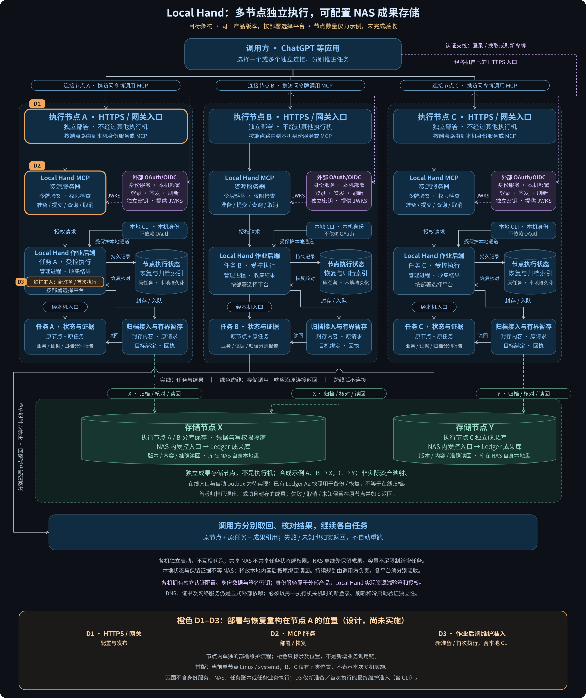

# 多节点独立 Local Hand 与 NAS 成果存储：实现方案

状态：目标设计与实施拆分，尚未完成跨平台多节点实现或部署验收。

目标是让同一个 Local Hand 产品版本分别部署到多个独立执行节点，覆盖 Linux ARM64、Linux x86_64 和 Windows AMD64。每个实例只执行自己的任务，拥有独立身份、权限、工作区、进程和恢复记录；调用方可以连接其中一个，也可以分别向多个实例提交任务，使任务跨节点并行。NAS 是独立的成果存储／服务节点，不因被使用而成为 Local Hand 执行节点。

本方案扩展部署形态、平台适配和成果存储接入，不改变原有职责主线：**调用方提出获准任务 → 指定节点受控执行 → 调用方核对原任务的状态与证据，继续工作**。不增加中央任务调度器，不让一个 Local Hand 代理另一个执行。

## 1. 基线与已有能力

本方案依据以下准确源码基线；“已有”不等于所有目标平台和部署节点均已验证。

| 对象 | 源码基线 | 能力与限制 |
|---|---|---|
| Local Hand | `bdca03384795236addc53c9df9cb1976b746b7bc` | 已有常驻 MCP、受限作业、原任务状态／证据和本地成果归档路径；当前执行与 prepare 链仍有 Linux 及 x86_64 假设 |
| Artifact Ledger | `78d6c5b07d47898083a47ac85d67cc5966b3760b` | 已有成果／版本／内容 API，以及封存快照向 NAS 发布、核验、恢复；没有在线多客户端归档服务或多租户权限接口 |
| 设计范围 | 本文、目标图的 Mermaid／SVG／PNG | 产品方案，不代表服务、业务任务、数据库、依赖锁或部署配置已经变更 |

上述 Ledger 基线中已验证的 A2 是“本地成果库 → 封存快照 → NAS → 新本地库恢复”，不是多个客户端远程打开同一个成果数据库。参见 [Ledger 基线说明](https://github.com/kongbu0621/infra-artifact-ledger/blob/78d6c5b07d47898083a47ac85d67cc5966b3760b/README.md)。

核心包的平台验证不能替代完整 MCP 与作业后端的原生验收。每个部署都必须核实实际宿主、操作系统和执行域；不能把虚拟机内部能力当作宿主能力。

## 2. 目标图与四个不同的概念

[可放大的 SVG](diagrams/independent-nodes-target.svg) · [PNG 预览](diagrams/independent-nodes-target.png) · [可编辑的关系源](diagrams/independent-nodes-target.mmd)

| 概念 | 负责什么 | 所在位置与边界 |
|---|---|---|
| 执行节点 | 准入、执行、查询、取消、收集结果 | 各自独立的 Local Hand；只能控制自己的执行域 |
| 节点执行与恢复记录 | 原任务身份、请求指纹、执行状态、退出证明、恢复关联与长期归档索引 | 各节点私有、可靠的本地存储；不是供多个执行节点共同写入的 NAS 数据库 |
| 有界待归档成果 | 封存证据、原归档请求、目标绑定、回执和重试状态 | 各节点私有暂存；有容量和保留规则，不是无限缓存 |
| 成果存储节点 | 保存成果身份／版本／内容，查询、核验、准确读回和备份 | 可绑定同一 NAS，也可分别绑定不同 NAS；不取得业务执行权 |

图中的节点 A、B、C 是三个合成示例，不限定部署数量，也不映射到实际设备。示例节点可以绑定同一存储节点，也可以绑定不同存储节点。**共用一台 NAS 不等于共用任务状态、凭据、写权限或同一个数据库。** 初版建议同一存储服务内按 producer 映射到独立的受保护成果库，降低跨节点越权和恢复耦合。

存储逻辑身份与物理位置分离：完整目标绑定为 `storage_id + store_id + producer + binding_revision + store_generation`。其中 storage 标识存储节点，store 标识该节点内具体成果库，binding 标识已批准的配置版本，generation 区分恢复／重建后的库世代。`storage_ref`／`store_ref` 是受保护配置中的引用；请求、响应和 outbox 必须核对解析出的完整身份。网址、IP、盘符和挂载点均不充当身份。

普通重启或凭据轮换不改变库世代；恢复前先停写、核验快照和原回执／幂等历史，显式批准恢复绑定后才开放。客户端不得自动接受服务端报出的新世代，世代数字本身也不证明历史完整。NAS 可以迁移位置，但既有任务的目标绑定不能随配置悄悄改变。

只抽象确有差异的边界：执行平台、执行身份、成果存储接入。不要把机器、NAS、任务进程强行实现成一个通用节点类，也不要为各部署维护分叉的工程副本。

## 3. 多连接与任务身份

### 3.1 调用方连接方式

每个部署使用可区分的连接标签，如合成示例 `Local Hand · Node A`、`Local Hand · Node B`。接口可以同名，但每次调用必须明确选择连接，并核对其返回身份；不能靠工具名称或模型记忆路由。

连接登记时固定预期 node／install；若绑定节点 A 的连接实际返回节点 B 身份，应拒绝，而不是照抄发现结果自动重绑定。合法更换安装由显式更新连接绑定处理，旧任务引用仍保留原来源。

OpenAI 文档允许自定义 MCP 应用与其他应用共同使用，但实际可选连接、工具权限与账户／工作区配置仍需实测。多连接不自动提供持续规划或无人值守调度；本方案只保证已接受任务由目标节点独立管理，持续推进下一步仍由调用方或另行授权的控制方决定。[官方接入说明](https://developers.openai.com/api/docs/guides/custom-mcp-server)

### 3.2 区分三层身份

1. **当前部署身份**：`node_id + install_uuid + deployment_epoch`，加实际执行域和部署能力描述。
2. **原任务身份**：原节点／安装身份、`operation_id`、提交主体和原请求指纹；与原始能力快照及证据封印关联。
3. **内部执行身份**：每次受控任务分配的 authority、ledger、manager 和进程／容器身份。它们不能替代稳定节点身份。

节点内使用 UUID 并不足以解决跨节点路由：两个节点即使出现相同 `operation_id`，查询、取消、证据读取也必须仍然互不影响。升级后同时报告当前服务部署与原任务来源，不能把旧任务“改籍”为当前部署。

进程重启不改变 node／install；普通升级按明确规则更新 epoch／版本，真正新安装产生新的 install UUID。稳定连接身份来自受保护 resident 配置，不能取自旧任务 policy 或每任务 authority。任务特定 profile／policy／registry 摘要在 prepare 中形成并绑定原任务；初始 capabilities 不伪造尚不存在的任务策略。

提交主体使用不可回收给其他身份的持久 `principal_id`。更换 issuer 或 subject 映射时，须核实同一主体的连续性；若是不同主体，只能显式授予所需旧任务权限，不能通过复用旧名字继承查询、取消或证据访问权。旧任务所有权不随当前登录配置改写。

### 3.3 具体接口改动

| 当前代码 | 拟修改点 | 必须保持的约束 |
|---|---|---|
| `tools/local_hand_jobs/contract.py`、`deployment.py` | 增加版本化节点控制封套；prepare、读取、查询、取消都绑定目标身份，能力发现返回稳定部署信息 | 保留 `lh-job-v1` 原字节、摘要和历史证据；旧客户端显式兼容或拒绝，不静默省略校验 |
| `tools/local_hand_mcp/resident.py`、`server.py`、`prepared.py` | 常驻能力发现保留原任务能力关联；所有入口核对当前目标与原任务来源 | 不能只在 submit 检查；错误节点在文件访问、prepare 和管理调用前拒绝 |
| `broker.py`、`state.py`、`evidence_client.py` 及客户端路由 | 原任务引用贯穿状态、取消、manifest、chunk、分页游标和证据缓存 | 缓存键至少含主体与完整任务／节点来源；不能只按 artifact ID 跨节点命中 |
| `tools/local_hand_connect/`、本地 CLI、受保护 manager 协议 | 端到端传递并校验目标封套和响应来源 | 本地或特权入口不能绕开网络入口的身份约束 |
| `tools/local_hand_mcp/auth.py` | 每个服务使用独立 resource audience、受控 issuer/JWKS 与主体映射 | 仅面向节点 A 的 token 不应可取消节点 B 的任务；NAS 凭据不能变为任务执行权 |

复用既有原请求去重与恢复机制。版本化控制封套是路由／准入边界，不再发明第二套业务执行协议。查询原任务时，显式区分“当前服务可处理该查询”和“历史任务由旧部署接受”。

prepare 不是永久执行许可。准备后发生升级、项目撤权或能力配置变化时，首次 submit 必须重验并绑定当前节点、主体权限／撤销、项目及能力版本；受保护 manager 的首次启动也须核对同一有效准入，不能只在 MCP 层检查后继续沿旧 policy 放行。不兼容的准备明确拒绝；只有证明尚未接受且无未决执行，才可按显式流程重新准备并保留旧准备关联。已接受或结果未知的任务继续沿原身份核对，不因升级重提。旧任务读取兼容不等于旧准备仍可首次执行。

### 3.4 并行与恢复

第一版维持每节点现有的保守并发上限：多个节点各跑一个任务即可形成跨节点并行。先不扩为单节点多 worker，不改变现有业务任务语义。

请求连接断开不等于任务取消。服务恢复只核对原任务和实际执行状态；确认失败、未知、结果丢失均如实返回。不得自动重新 submit，也不得让健康节点接管离线节点任务。

## 4. NAS 成果归档：最小新增实现

### 4.1 仓库责任与接入方式

Local Hand 增加有界归档 outbox、上传／核对客户端，以及原任务到成果引用的映射。优先扩展现有 `artifact_archive.py` 与相关证据路径，不另建执行系统。

Ledger 增加可选的固定归档接收／查询／读回适配层，复用其公共 `execute`、`get_operation`、`get_record`、`read_blob`、`verify`；不复制事务逻辑，不让 Ledger 核心依赖 Local Hand 私有任务字段。

优先采用受认证 HTTPS 固定接口；如果现场已有同等受限、可审计的固定入口，可在实施清单中明确替换传输。必须在实现前固定传输、认证、资源限制和恢复契约，不能以“抽象接口”代替它们。该入口不是新的 Local Hand、通用远程 shell、任意 Python 执行或共享 SQL 接口。

首版目标图采用明确主路径：**接收端运行在 NAS 内受控环境，Ledger 库位于 NAS 自身经过验证的可靠本地文件系统**，由一个逻辑写入者提交；客户端不通过 SMB/NFS 直接打开数据库。实际 NAS 是否具备此运行条件需要现场验证。

若改由独立存储宿主承载接收端和本地成果库，必须另列“宿主 Ledger 已提交”与“NAS 已发布并读回验证”，完成后续 A2 快照发布／回读才可称 NAS 保存。前者不能冒充后者，图也必须增加宿主到 NAS 的实际链路。接收宿主不得必须依赖另一执行节点，否则不能宣称该归档路径独立于执行节点。

NAS 若不具备运行接收端的条件，可以先复用已有“本地成果归档 + A2 封存快照发布”作为明确标注的过渡能力，但这不算在线多客户端归档目标已经完成。无需重做已验证的 Ledger A2。

### 4.2 受保护目标与权限

- 部署配置保存目标、信任材料、存储身份、绑定版本、允许的 producer 和成果库；业务任务只能引用已批准的 `storage_ref`，不能提供任意 URL、挂载路径或凭据。
- 服务端由认证主体映射 producer 和授权成果库，不信任请求中自报的节点名字。`namespace_ref` 只是数据，不是鉴权。
- 初版不共享跨 producer 的可写库。需要跨节点读取成果时，单独授予只读范围；不因使用同一 NAS 自动放开。
- 收到请求先验证身份与目标，再按长度、条数、单体和累计预算有界接收；有界排队并限流。沿用 Ledger 实际内容上限，不能用流式上传绕过单项或总量限制。
- 身份／权限失败不轮换到其他主体重试；网络超时与服务暂不可用采用有上限退避和稀疏日志。

`producer` 由受保护登记固定绑定原 `node_id + install_uuid`，不使用机器显示名或令牌值代替。真正新安装登记新的 producer；普通凭据轮换保持原 producer／store，秘密通过独立受保护引用更新，不改归档 key，也不继续使用已撤销的旧凭据。现有归档 scope 只绑定 `(producer, operation_id)`，因此这一安装作用域约束必须在生成新归档前生效；历史 producer、原请求字节和 scope 保留，通过显式兼容登记关联，不以新字段重算旧身份。

普通节点操作面只含目标身份／限额发现、原 create／append 提交、原幂等请求查询、授权记录与 blob 读取。初始化、恢复、导入、删除、库路径选择和服务管理留给独立运维入口，不因归档权限一并开放。

### 4.3 outbox 与幂等契约

以下是拟新增设计，不是当前已实现的自动归档能力。

1. 对需要保证成果保留／归档的任务，准入时预留本地耐久空间并记录归档意图；空间不足拒绝新增任务。
2. 首版沿用当前归档消费者的准入：`TERMINAL / EXITED / SUCCEEDED / SEALED`。符合条件的原任务发布 outbox 项；失败、取消、UNKNOWN 的执行记录和可用证据保留在原节点并如实返回，不宣称已覆盖其 NAS 归档。扩展这些成果类型须单独定义映射与负向测试。项内保存完整原任务来源、封印、不可变内容或受保护引用、长度／摘要、完整逻辑目标及绑定版本。
3. 一次生成并持久保存 Artifact、Version、Blob 等 ID，保存原 create／append 请求字节、各自原生幂等三元组与指纹。归档 operation 与业务 operation 明确区分。
4. 相同幂等身份只能接受相同指纹；内容摘要是被绑定的值，不能把变化的摘要加入 key 来掩盖冲突。首版不增加独立异步接收队列或第二份提交真相；诊断 correlation ID 不替代 Ledger 原三元组。
5. create 和 append 是两个事务：create 成功、append 未知时保留前者，沿原 append 核对；不能假称二者可以整体自动回滚。
6. 用原目标、原 key 核对原回执，并对准确版本、长度和真实内容摘要读回验证。仅收到 HTTP 200、metadata 或 marker 不算“成果已归档且可核对”。
7. 确认与保留条件均满足后，只回收允许删除的本地内容并释放其实际占用；未确认、未知或被保留的项不得因清理或升级消失。

待上传内容与长期归档索引分开管理。原任务到完整存储绑定、准确成果／版本、原请求字节及指纹、回执的关联必须耐久保留；查询或重复归档不能把 outbox 项消失当作从未归档，重新生成 ID 或请求。这些保留记录也计容量；到达上限时停止相应新增准入，不删除幂等历史腾空间。

释放本地内容前，必须实现并验收经原节点、原绑定的受授权准确读回，按原封印核对内容；未满足时保留本地可读副本。当前 `artifact_archive.py` 的恢复仍依赖完整本地目录，不能直接删除文件来实现清理。释放后，任务状态仍可本地查询，但证据内容可能依赖 NAS；NAS 不可用时如实返回内容暂不可取，保留过去的确认事实，不重跑业务。图中的返回箭头表示经原节点返回，不保证所有证据永远无需访问 NAS。

接收端的最终持久化与幂等提交以 Ledger 原事务为准，保留原 `commit_state`、`result_ref` 等字段语义。单个节点只有一个受互斥保护的归档消费者；所有待发送、失败、未知项和中间文件都计入节点／项目字节与条数预算。不同目标公平轮询，某目标超时不得永久阻塞其他目标。对重试次数、单次超时和日志速率设限，达到自动重试预算后保持待人工处理状态，而不是丢数据。

服务端还须为每库及服务总体设累计准入上限，覆盖存量内容、记录数、原请求／幂等历史、接收暂存和备份／恢复开销。上限取所选提交、检查点、备份、恢复和核验链能共同处理的范围，而非 NAS 剩余空间或单请求上限；准入预留须与并发提交互斥。当前消费者恢复依赖全库 `export_bundle`，其总量限制与 A2 快照限制不同；P1 必须固定实际恢复路线和安全余量，验证多次合法追加后的边界。达到上限前背压，不自动换库、改目标或删除历史绕过；扩容须先证明对应恢复链可覆盖新增容量。

发布终态、封存证据、发布 outbox 并非天然一个事务：必须保存可恢复意图，以原任务身份识别“已封存但未入队”和“已确认但未清理”，补齐归档步骤；恢复扫描不得调用业务 submit。每个崩溃窗口均须注入测试。

### 4.4 成功与失败分别表示

保持三个独立维度：`business_outcome`、`evidence_state`、`archive_state`。下列归档状态名称为拟议设计；实施时以版本化契约固定。

| 事件 | 处理与可报告事实 |
|---|---|
| 归档尚未确认时 NAS 不可达 | 保留本地证据；未发送项保持 pending，可能已提交项保持 unknown；业务成功不冒充归档成功，不重跑业务 |
| 归档已确认后 NAS 不可达 | 保留过去确认事实，另报当前内容可读性；已释放本地内容时不伪造可读，也不降回待归档或重跑 |
| 接收提交后响应丢失 | 归档 unknown；查询原请求，必要时只重送完全相同的归档请求 |
| 原请求查询 NOT_FOUND | 不是永不提交的证明，原请求可能仍在执行；不得换 key／目标规避 |
| 回执匹配，但内容不可读／损坏 | 不能报告 verified；保留损坏／未知事实，不自动重写既有版本 |
| 本地 outbox 满 | 对需保证证据／归档的新任务背压或拒绝，不删除未知项腾空间 |
| NAS 满或权限改变 | 分清明确未提交、已提交、未知；不循环创造新成果 ID |
| 更换 NAS 绑定 | 新任务可绑定新版本；已发送／未知项继续核对原目标，不自动迁移或双写 |
| NAS 恢复到旧快照 | 使用显式恢复绑定／库世代，核对回执与幂等历史；不能凭同一 URL 假定历史完整 |
| 本机状态盘丢失 | 停止新写入并进入恢复流程；不能静默创建空状态库继续使用旧节点身份 |

NAS 故障可以影响共享它的多个节点的归档，这是明确的共同故障域，不是执行节点相互依赖。只有任务本身需要 NAS 输入／远端提交，或本地保留预算耗尽时，才阻断相应新任务；不能承诺无限离线工作，也不能把所有任务启动都绑在 NAS 健康上。

恢复到旧快照后，分别保留“过去已确认的原回执”和“目前成果缺失／不可读”的事实；不回滚本机业务状态，也不把旧任务重新列为待执行。若需恢复原成果，只按显式恢复流程使用原封存内容，不重新执行业务生成替代品。

恢复换代先关闭旧写入入口、确认在途写入结束并阻止旧写入者继续提交，再核验所选恢复点。以追加式恢复绑定记录原目标到新世代的映射及核验依据，原 outbox、请求与回执不原地改写。只有明确纳入恢复绑定且已核对原幂等历史的请求，才可经新世代查询或按恢复规则继续同一归档请求；缺失已确认历史不能解释成从未提交。旧世代写入须被拒绝，延迟回执仍按其原世代核对，不能冒充新世代当前完整性的证明。当前 `bind_restored` 要求匹配受信检查点与完整历史，不能把它当作接受任意较旧快照的现成能力；超出已证明恢复范围时保持只读／待处理。

## 5. 跨平台实现与发布

第一版各目标平台必须交付相同的最低作业面：`host.inspect`、已登记项目的受限 `workspace.edit` 及其固定验证，以及 prepare／submit／query／cancel／证据读回／原任务恢复。项目、工作副本、验证命令和输出预算逐平台登记。固定验证不是任意命令执行入口。

任一平台只有能力发现、或缺少上述共同必需能力，都只能算受限候选，不能算该平台版本完成。GPU 作业、NAS 新业务作业、任意 shell 和跨节点任务迁移不在该共同能力承诺内。

### 5.1 先验证高风险路径，再抽接口

保留 Linux 现有行为，按实际需求抽取：受保护文件、实例互斥、本地 IPC、时钟与生命周期身份、manager 绑定、进程树控制、工作区隔离、存储预算，以及状态／配置／outbox 的锁、原子发布和耐久性。`artifact_archive.py` 的 fcntl、POSIX owner、目录 fsync 等也需适配。配置选择后端，请求方不能任意指定后端或放宽约束。

现有 `manager_binding.py`、`runner.py`、`task_session.py`、`budget.py` 与受保护管理服务带有 Linux 假设。新增带平台判别的版本化绑定／证明，保留旧记录解码，不能给 Windows 伪造 cgroup、UID、device/inode 或 Linux 启动身份。

### 5.2 Linux ARM64 与 x86_64

- 基线中的 `tests/e3_host/q2_prepare.py` Quota 路径限制 x86_64。当前源码候选已为该路径及容量核验器 `q2_core_delivery_dispatcher.py::_CapQuota` 增加小端 LP64 aarch64 的类型宽度、对齐和逐字段偏移检查，并以同一原生 C 头文件探针对照验证。两者都要求 GET／GETNEXT 返回完整有效字段；容量观察仍禁止写入命令，原受控准备写入边界不变。这只解决所述入口的 ABI 与返回校验问题，不代表真实配额、其他原生 helper 或完整 ARM64 部署通过。
- 原生编译 ABI probe 和 native helper，核对结构大小、字段偏移、字节序与系统调用，再在获准隔离文件系统上验证字节／inode 配额、继承、保留任务占用及重启恢复。C helper 有 aarch64 分支不等于整条 prepare 已通过。
- 验证实际文件系统、配额挂载、设备和文件系统身份；不要直接更改生产根盘。缺少条件就拒绝相应能力或先准备获准专用存储。
- 验证 DMI／替代主机身份与执行域绑定；ARM64 不一定具有与 x86 相同的 DMI 来源。
- 当前受保护 prepare 复用测试目录 helper：应抽出单一生产实现并让测试复用，或作为受校验安装载荷明确交付，不能依赖偶然存在的开发目录。
- Linux x86_64 保留现有后端行为，并回归上述接口抽取涉及的准入、准备、执行、取消和恢复链；一个部署的验证不自动证明其他内核、文件系统或执行域受支持。

### 5.3 Windows AMD64 原生

- Windows Service 常驻，无需桌面登录；受限账户／令牌、ACL/SID、受认证本地 IPC、受保护配置与单实例锁。
- 进程在约束建立后才开始业务执行；实现 Job Objects 与进程树管理、取消、停止证明、管理服务异常后的原任务恢复。Job Objects 不是完整安全沙箱，必须防止 WMI、服务、计划任务等旁路创建未受控进程；不能仅靠一次通知证明全部退出。
- 首版选择保守策略：受保护 manager 持有不可被任务继承／复制的 Job 控制句柄，最后受控句柄关闭触发进程树终止；manager 崩溃后核对退出与原任务，保留失败／未知，不重放。MCP 与 manager 分进程，单独重启 MCP 不应关闭管理句柄。此策略必须在 P1 证明；不能同时承诺 manager 崩溃后任务一定继续。
- 路径测试覆盖盘符、UNC、大小写、长路径、hard link、junction 和 reparse point；授权检查和实际打开对象必须一致。
- NTFS 用户／卷配额不是 Linux 项目目录配额。固定容量任务卷可作为候选，但还须证明文件数量／元数据、临时文件、日志、证据和保留任务边界；不能默默删掉 `storage_inodes` 等承诺。若只能提供不同约束，应新增明确能力 profile 和契约，不宣称等价。
- 替代存储 profile 必须给出可强制的字节、对象／元数据、临时与管理开销上限及限制；缺少共同必需的资源保障就不能公布对应作业能力。Windows 安装态须同样通过 outbox 崩溃／原子发布／耐久性测试，不能只复用 Linux 协议测试。
- P1 还须逐项固定 CPU、内存、进程／线程、时间和存储预算的统计对象、执行阶段、强制点及超限行为。当前 Linux 的 `processes` 映射为包含线程的 `TasksMax`，不能直接换成 Windows 的进程数量限制；CPU 时间／速率、内存统计也不能凭同名同数值宣称等价。通过线程洪泛、多进程合计 CPU／内存、绕向任务卷外可写目录的负向测试证明边界；差异必须进入版本化 profile，不能降低共同保障而仍报兼容。
- 区分 OS 启动、服务世代、任务执行实例与时间预算；明确挂起／休眠是否计时，测试 Fast Startup、恢复和墙钟回拨。服务重启生成的 UUID 不能冒充 OS boot ID。
- 初始原生验证目标为 Windows 11 AMD64；其他 Windows 版本另行说明支持范围。WSL／VM 可作为另选执行域，但不冒充 Windows 宿主原生能力。设备具有 GPU 不代表已支持 GPU 作业；驱动、计算运行时、GPU 权限和固定作业 profile 需另行准入。

参考：[Microsoft Job Objects](https://learn.microsoft.com/en-us/windows/win32/procthread/job-objects)、[Job 基础资源限制](https://learn.microsoft.com/en-us/windows/win32/api/winnt/ns-winnt-jobobject_basic_limit_information)、[systemd 资源控制](https://www.freedesktop.org/software/systemd/man/latest/systemd.resource-control.html)、[NTFS 配额策略](https://learn.microsoft.com/en-us/windows/client-management/mdm/policy-csp-admx-diskquota)、[Windows 时间语义](https://learn.microsoft.com/en-us/windows/win32/sysinfo/windows-time)。

### 5.4 同版本，不同安装制品

一个版本号与 source commit，对应 Linux x86_64、Linux aarch64、Windows AMD64 各自的依赖锁、wheel、原生 helper、受保护管理载荷、安装／卸载／回退程序及能力证据。先核实每个部署的操作系统、架构及实际执行域，再选制品。

当前 wheel 包清单不足以独自交付完整受保护 prepare／管理链。发布 manifest 必须覆盖全部运行载荷、Python ABI、依赖与文件摘要；每台在没有源码工作区的干净安装环境验证。构建锁不可直接跨架构套用。

升级可分别进行；只要求明确协议兼容范围，不要求各节点同步重启。不兼容版本明确拒绝操作。旧任务以原协议／原身份查询，不通过重新执行产生“新版本结果”。

## 6. 启动、认证与网络独立性

每台把本地安全恢复与网络新准入分开：

1. `系统启动 → 本地身份／状态盘／互斥检查 → 受保护管理服务与原任务恢复`。默认关闭新业务准入；本地维护通道仍须验证操作系统身份与权限，只用于核对原任务、收尾及获准的停止操作，不重新提交业务。
2. `系统启动 → 本机代理（需要时）→ 必要出站依赖检查 → MCP 启动 → 本机认证就绪探测`。只有管理服务就绪、权限和依赖检查均满足后，才开放获准的新业务准入。

两支可以并行。issuer／JWKS 不可达不得阻止第一支启动，也不能成为第二支放行未认证请求的理由。随后从实际外部入口验收连接、认证和节点身份，确认对外可用。启动前不检查尚未启动的自身 MCP 入口，避免自依赖；本地恢复、网络认证就绪与外部可达分别报告。

需要代理的部署分别使用获准的本机配置，不复制其他节点的身份或凭据。后台核心先在隔离端口验证，再安排端口唯一所有者和受控切换；不能以桌面登录后的交互式自启动代替系统服务。

HTTPS 检查使用实际服务用户与其网络／代理设置，验证 TLS、预期响应及必要认证。清单分层：MCP 网络入口启动前只检查真正必要的外部依赖（如身份发现／JWKS）；启动后核对本机认证与实际外部 MCP 路由；任务特有端点在对应任务准入／执行阶段检查，不能阻断无关任务和可安全完成的原任务恢复。浏览器可上网或端口开放不算通过。`auth.py` 的 HTTP 客户端使用 `trust_env=False`，故仅设置 `HTTPS_PROXY` 不足；当前源码候选提供受保护的可选 `document_proxy_url`，仅作用于认证文档读取，回环地址直连且保持 TLS 验证。配置与回退说明见 [使用说明](USAGE.md#job-service-deployment-inputs)，实际服务用户和外部入口仍须现场验收。

每次检查有超时，失败有间隔与退避，日志限速；启动互斥避免重复实例。恢复只启动服务、核对原任务和原归档，不重放业务。NAS 归档消费者单独恢复，不作为不相关任务的全局启动前置条件。

外部入口或认证刷新失效时按策略拒绝新的未获准操作，不自动停止或重提已接受任务；原任务管理与网络就绪状态分开。身份校验不得为保持可用性而失效放行。

代理配置保留 localhost、127.0.0.1、::1 直连与正常 TLS 校验。部署若包含桌面客户端，应分别验证桌面启动和命令行启动的实际网络环境；不能仅凭交互式 shell 配置推断客户端可用。

逐项盘点 DNS、证书签发／续期、issuer/JWKS、反向代理／隧道、网络出口、密钥保管、项目路径与状态盘的宿主。未发现源码硬编码其他节点，不等于部署无依赖：若一个节点的认证或入口仍由另一执行节点承载，必须解除该依赖或明确标为不满足独立部署。公共外部服务可成为声明的共同依赖，不能隐藏。

## 7. 按交付物推进

| 阶段 | 交付内容 | 进入下一阶段的证据 |
|---|---|---|
| P0 部署条件与契约确认 | 执行线确认各节点执行域、身份／入口及控制封套；归档线确认存储绑定和协议 | 各线分别核对实际 OS／权限／文件系统／网络条件；不把假设填为已支持，NAS 未就绪不阻断独立平台检查 |
| P1 高风险隔离验证，可并行 | Linux ARM64 quota ABI／身份；Windows 进程约束／IPC／ACL／存储硬边界／时钟；Ledger 受控接收、原请求恢复与全库容量边界 | 原生运行与负向测试通过；恢复链覆盖累计准入上限；不支持项明确拒绝，先修正能力契约再扩实现 |
| P2 身份与平台实现 | 全入口目标校验；公共核心最小抽取；保留 Linux 行为；新增 Windows 原生后端 | 原功能回归、错节点零副作用、隔离进程／协议层多实例并行、平台假设不跨边界泄漏；不冒充实际节点部署验收 |
| P3 成果存储接入 | Local Hand 有界 outbox／客户端；Ledger 最小固定接收／核对／读回适配 | 响应丢失、重复归档、崩溃、满盘、权限变更、旧快照恢复、绑定变更测试 |
| P4 跨平台安装与自启动 | 按平台制品、锁和 manifest；系统服务／代理／实际 HTTPS 就绪检查；回退工具 | 干净安装完整链路、无需桌面登录、重启不重放；部署包含桌面客户端时验证其启动路径 |
| P5 逐节点及联合验收 | 各自安装态验收，再由多个节点同时执行不同合成任务；同 NAS 与不同 NAS 绑定 | 下述验收矩阵及原始结果、提交和制品摘要齐全；未通过项不得以历史证据补位 |

执行线为平台清单 → P1 平台验证 → P2 → 对应平台 P4；归档线为存储现场与协议 → P1 接收验证 → P3。两线在 P5 汇合，未取得 NAS 条件不阻断平台工作。P1 的存储硬边界结果决定平台实现，不应先承诺一个看似统一、实际不可兑现的资源模型。P2 与 P3 在契约固定后可并行；完整产品发布需同时满足对应平台安装与端到端验收。受限中间版本应如实列出支持范围。

## 8. 验收矩阵与反向检查

| 维度 | 必测情况 | 通过条件 |
|---|---|---|
| 多节点并行 | 不同节点使用不同内容；故意复用 operation UUID；一个节点取消／离线 | 其他节点不受控制影响；结果与原节点／任务准确对应 |
| 全入口路由 | 错节点 prepare／submit／status／cancel／workspace／manifest／chunk；错游标与缓存 | 在任何副作用和跨任务读取前拒绝；不能通过本地 CLI 或 manager 绕过 |
| 发现与兼容 | 绑定节点 A 的连接实际路由到节点 B；严格入口收到缺目标的旧请求 | 拒绝自动重绑定／降级；兼容入口显式，原业务请求及历史封印字节不变 |
| 身份与升级 | 错 audience、过期／撤销权限；prepare 后升级／项目撤权；更换 issuer／subject；新安装复用 operation UUID | 旧准备不得绕过当前首次准入；主体名字不转移旧任务权限；新安装不碰撞旧 producer/scope；原来源保留，历史任务不重执行 |
| 进程与重启 | HTTP 断连、MCP 重启、manager 崩溃、主机重启、子进程逃逸 | 已接受任务状态可核对；退出证明可信；不自动提交／接管 |
| 平台安全 | ARM64 ABI 与真实配额；Windows IPC／ACL／Job／旁路；线程洪泛、多进程资源总量、卷外写入 | 逐预算语义明确；未获准访问与资源超限真实受阻；无法证明就不公布该能力 |
| 时间边界 | 挂起／休眠、Fast Startup、服务重启、墙钟回拨 | 生命周期不混淆，预算规则可重复验证，过期权限不复活 |
| NAS 隔离 | 同 NAS 不同 producer；不同 NAS；伪造 storage_ref／身份 | 授权范围明确，跨库写入拒绝，NAS 无业务执行入口 |
| 归档事务 | create 成功 append 未知；提交后断网；NOT_FOUND；同 key 异内容 | 沿原请求收敛或保留未知；不产生重复业务／冲突版本 |
| 成果完整性 | 封印篡改、错误版本、缺 blob、内容损坏、伪造回执 | 状态不虚报 verified；准确读回校验可重做 |
| 容量与排队 | 本地／NAS 满、项数超限、慢上传、超大请求、重试风暴；多次合法追加／并发提交跨越全库恢复上限 | 有界内存／磁盘／队列／日志；预留与提交不超卖，准入容量可备份／恢复／核验；未知证据保留，新增任务合理背压 |
| 崩溃窗口 | 封存前后、入队前后、接收提交后、确认与清理之间 | 恢复原归档链，不丢唯一证据，不调用业务 submit |
| 清理后读回 | 已确认内容清理后重启、旧任务查询／读回、重复归档、NAS 离线 | 原映射／请求／回执保留；准确内容可核对，离线时不伪造可读；重复归档不新增写入，保留记录仍计预算 |
| 存储恢复 | NAS 旧快照恢复、库世代改变、在途旧写入／延迟回执、凭据轮换后核对 unknown、挂载身份不符 | 原绑定与恢复映射可核对；旧写入者受阻，延迟回执不证明新世代完整；不重算 key、不自动双写／切目标、不静默建空库 |
| 启动链 | 无桌面登录冷启动、issuer 不可达、代理失败恢复、JWKS 刷新、服务账号 HTTPS | 断网时本地原任务恢复仍可用、不重放；网络新准入须满足依赖与授权，无重复进程；保持 TLS 和回环直连 |
| 安装与回退 | 无开发 checkout；逐机滚动升级；旧记录读回 | 载荷完整可追溯；兼容判定显式，回退不重放任务 |

验收分层：静态／编译检查 → 单元与协议负向测试 → 平台原生隔离测试 → 安装态测试 → 实际部署与联合链路。每层记录准确 commit、制品摘要、环境、命令、退出码及原始输出位置；SKIP、unsupported、timeout、unknown 不改写成 PASS。公开报告只保留适合披露的能力结论和制品身份，凭据、实际设备映射与原始部署证据保持私有。

完成后按实际返回状态反查链路：所有任务核对返回状态 → 原任务身份／请求 → 执行绑定／权限 → 指定连接；声明 `SEALED` 才要求证据清单、封印与内容一致；声明归档已核验才追加准确成果版本 → 完整存储绑定 → 原归档请求／回执 → 实际读回内容。失败、取消、UNKNOWN 或未归档结果不要求凭空补出封存与归档证明；过去已核验与当前可读性分开报告。对应声明无法核对时，不能用“进程运行”“有文件”“HTTP 200”替代。

## 9. 部署与回退边界

实现阶段先使用隔离目录、身份、端口、合成任务与受控测试成果库。现有环境、安装和历史证据的保留或迁移须有明确清单；新部署不得隐式恢复旧执行入口或重放原业务。

部署验收按节点推进：备份配置和一致性状态 → 安装候选 → 隔离链路验证 → 记录切换点 → 切换唯一服务实例 → 在线验证 → 无桌面登录的重启验收。代理和远程入口切换必须保留独立恢复通道；重启验收采用明确维护窗口，不以丢失管理连接作为成功证明。

回退服务前停止新准入并核对在途任务；保留新旧任务状态和归档请求。只恢复兼容的程序与配置，不用旧快照覆盖较新的任务库或幂等历史。无法安全回退时停在只读／恢复模式，不重新执行业务。NAS 的回退是独立、显式的存储恢复流程。

实施所需的部署条件包括各节点访问权限、Windows 服务／隔离存储所需管理员权限、Linux 获准的配额文件系统、独立认证及入口配置，以及 NAS 接收端能力和存储授权。缺少时报告具体条件，不借用其他节点身份或绕开安全检查。

本文与图稿不构成运行态完成证明，也不自动授权新增 GPU 作业、跨节点任务转移、共享可写状态或 NAS 任意执行。

## 10. 设计校核与实现接续

方案和图稿应保持以下一致性：

- 调用、执行、结果返回构成主线；成果存储是独立分支，不成为所有任务的无条件前置。
- 图中的合成节点不表达实际设备、固定节点数量或已验收的平台映射。
- 关系源、SVG 与 PNG 的节点文字、方向和标签应一致；文本解析、渲染与实际运行验收分别报告。
- 身份／并行、存储／归档和平台边界的变更应同时检查接口、状态、失败与恢复语义；编译检查不能替代依赖安装或原生后端验证。
- 产品设计不记录具体部署凭据、主机映射或原始运维输出；此类配置和证据使用独立的私有部署记录。

实现从 P0／P1 开始：确认目标部署的执行域，验证 Linux ARM64 配额与 Windows 原生隔离／存储边界，并独立确认 NAS 接收条件。只有对应阶段的实际证据通过后，才能更新平台支持和部署完成状态。
